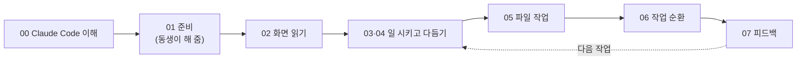

# Claude Code 기초 강의

Claude 데스크톱 앱의 **Code 탭(Claude Code)**으로 문서·엑셀 작업을 하는 법을 배우는 짧은 강의입니다.
코딩은 몰라도 돼요. 순서대로 한 편씩 읽고, 궁금한 건 언제든 물어보세요.

## 전체 그림

## 목차

| # | 주제 | 한 줄 요약 |
|---|---|---|
| 00 | [시작 전에](lessons/00-시작-전에.md) | Claude Code가 뭐고 왜 쓰나 |
| 01 | [준비하기](lessons/01-준비하기.md) | 설치와 작업 폴더 (동생이 세팅) |
| 02 | [화면 읽는 법](lessons/02-화면-읽는-법.md) | 볼 것, 무시해도 되는 것, 허락 요청 |
| 03 | [첫 작업 맡기기](lessons/03-첫-작업-맡기기.md) | 좋은 지시의 네 가지 |
| 04 | [이어서 다듬기](lessons/04-이어서-다듬기.md) | 고쳐 달라기 + 자주 쓰는 말 |
| 05 | [파일 작업 예시](lessons/05-파일-작업-예시.md) | 엑셀 읽기, Word 만들기, 비교하기 |
| 06 | [**작업 순환**](lessons/06-작업-순환.md) | "시작하자" → 작업 → "마무리하자" |
| 07 | [피드백 주고받기](lessons/07-피드백-주고받기.md) | GitHub로 동생과 주고받기 |
| 08 | [꼭 지킬 것](lessons/08-꼭-지킬-것.md) | 비밀, 원본, 허락 요청 |
| 09 | [자주 묻는 질문](lessons/09-자주-묻는-질문.md) | 질문이 생길 때마다 추가 |

부록: [작업 폴더 템플릿](workspace-템플릿/) — 동생이 세팅할 때 쓰는 파일

## 한 줄 요약
**"시작하자"로 열고, "마무리하자"로 닫는다.** 그 사이에 쌓인 노하우가 다음 작업을 더 빠르게 만든다.

> 앱 메뉴 이름은 버전에 따라 조금 다를 수 있어요. 화면이 설명과 다르면 캡처해서 물어보세요.

📖 공식 문서: [데스크톱 앱의 Claude Code](https://code.claude.com/docs/en/desktop) · [시작 가이드](https://code.claude.com/docs/en/desktop-quickstart) · [메모리(CLAUDE.md)](https://code.claude.com/docs/en/memory)
