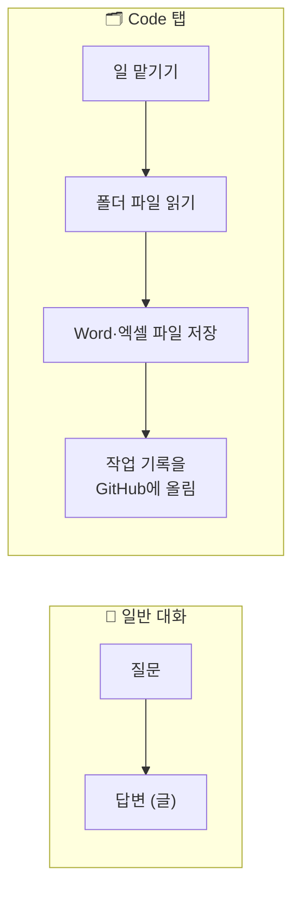

# 00. 시작 전에

## Claude Code란?
Claude 데스크톱 앱의 **Code 탭**이에요. 원래 개발자용이지만, 하는 일은 단순해요:
**내 PC 폴더 안의 파일을 직접 읽고, 고치고, 새로 만든다.**

## 왜 Code 탭을 쓰나
| | 일반 대화 | Code 탭 |
|---|---|---|
| 파일 | 하나씩 첨부 | **폴더째로** 읽고 저장 |
| 지침 | 매번 설명 | `CLAUDE.md`에 한 번 써 두면 **자동으로 읽음** |
| 배운 것 | 대화 끝나면 사라짐 | 노하우·스킬로 **폴더에 쌓임** |
| 동생 피드백 | 어려움 | **GitHub로 주고받기** |

## 기억할 것
- 코딩은 몰라도 돼요. **평소 말로** 시키면 됩니다.
- 화면에 개발자용 정보가 많이 보여도 겁먹지 마세요. 볼 것만 보면 돼요 (02편).
- Claude는 **빠르고 성실한 신입**이에요. 맥락을 잘 주고, 결과는 꼭 검토하세요.
