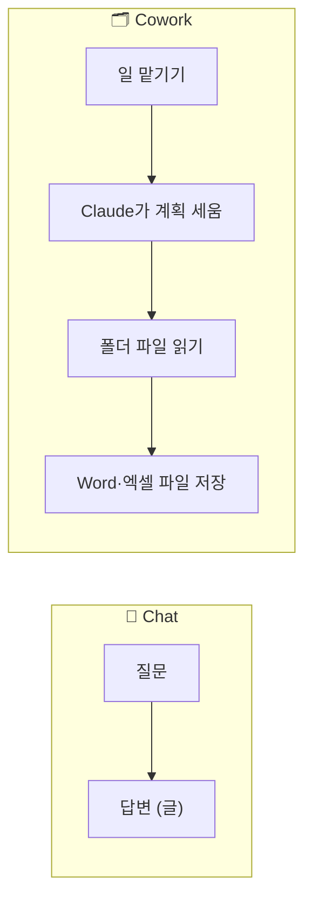

# 00. 시작 전에

## Cowork란?
**Cowork**는 Claude 데스크톱 앱에서 **내 PC 폴더의 파일을 직접 읽고, 결과 파일을 만들어 저장**해 주는 기능이에요.
일반 대화(Chat)가 "물어보고 답 듣기"라면, Cowork는 **"일을 맡기고 결과물 받기"**예요.

## 앱의 세 가지 모드
| 모드 | 하는 일 | 우리는 |
|---|---|---|
| **Chat** | 일반 대화. 파일은 하나씩 첨부 | 간단한 질문 |
| **Cowork** | 폴더의 파일을 직접 읽고, 결과 파일 저장 | ✅ **주로 이걸 씀** |
| **Code** | 프로그램 개발 (GitHub 연결 등) | ❌ 안 써도 됨 |

> 📌 최신 앱에서는 Chat과 Cowork가 **하나로 합쳐진 화면**일 수 있어요. 그럴 땐 그냥 일을 말하면 Claude가 알아서 Cowork 방식으로 처리해요.

## 준비물
- 유료 요금제(Pro 이상)
- **Claude 데스크톱 앱** (Windows). 내 PC 폴더를 쓰려면 앱이 켜져 있어야 해요.

## 기억할 것
- 명령어나 코딩은 필요 없어요. **평소 말로** 시키면 됩니다.
- Claude는 **빠르고 성실한 신입**이에요. 맥락을 잘 주고, 결과는 꼭 검토하세요.

📖 공식 안내: [Cowork 시작하기 (한국어)](https://support.claude.com/ko/articles/13345190) · [Cowork 개요](https://claude.com/docs/cowork/overview)
