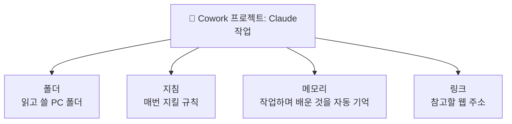
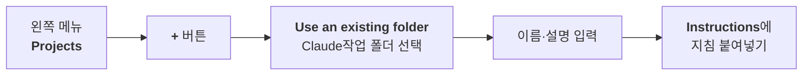

# 01. 작업 폴더와 프로젝트 만들기

Cowork에는 **프로젝트**라는 작업방이 있어요. 프로젝트 하나에 아래가 묶여요.



**한 번 만들어 두면, 그 프로젝트에서 시작하는 모든 작업이 같은 폴더·지침·메모리로 시작해요.**

## 1단계: 폴더 만들기
Google Drive나 OneDrive 안에 만들어요. (공유하면 동생이 피드백을 줄 수 있어요 → 06편)

```
Claude작업/
├── 노하우.md      ← 작업할수록 쌓이는 요령 (Claude가 갱신)
├── 피드백.md      ← 동생 피드백
├── 재사용/
│   ├── 지시문/    ← 잘된 지시문
│   └── 견본/      ← 잘된 결과물 견본 (비식별)
├── 자료/          ← 작업할 파일의 "사본"
├── 결과물/        ← Claude가 만든 파일
└── 작업일지/      ← 작업마다 남는 기록
```
빈 폴더와 빈 `노하우.md`, `피드백.md`만 만들어 두면, 나머지는 Claude가 채워요.

## 2단계: 프로젝트 만들기

- 지침은 [부록 템플릿](../templates/지침.md)을 그대로 복사해서 붙여넣으세요.

## ⚠️ 두 가지 원칙
- **원본은 넣지 않기.** Claude는 파일을 고치거나 만들 수 있어요. 항상 **사본**을 `자료/`에 넣으세요.
  (영구 삭제는 반드시 허락을 묻게 되어 있어요.)
- **민감한 정보는 지우거나 바꾸기.** 이름 → A, B / 회사 → 甲사 / 주민번호·연락처 → 삭제

📖 공식 안내: [프로젝트로 작업 정리하기](https://claude.com/docs/cowork/guide/projects)
