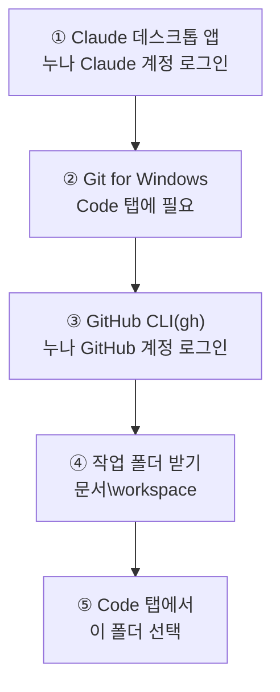
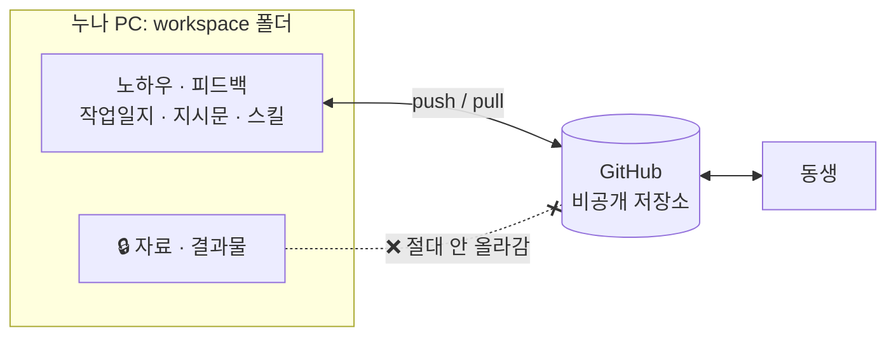

# 01. 준비하기

> 🙋 이 편은 **동생이 처음에 한 번** 해 주는 세팅이에요. 누나는 어떤 게 깔리는지만 알면 돼요.

## 설치되는 것


## 작업 폴더 구조
```
workspace/
├── CLAUDE.md          ← Claude가 매번 자동으로 읽는 규칙 ✨
├── 노하우.md          ← 작업할수록 쌓이는 요령
├── 피드백.md          ← 동생 피드백
├── 작업일지/          ← 작업마다 남는 기록
├── 재사용/지시문/     ← 잘된 지시문
├── .claude/skills/    ← 잘된 방식이 스킬로 쌓이는 곳
│
├── 자료/              ← 작업할 파일 "사본"     🔒 GitHub에 안 올라감
└── 결과물/            ← Claude가 만든 파일     🔒 GitHub에 안 올라감
```



## 동생 체크리스트
- [ ] [Claude 데스크톱 앱](https://claude.ai/download) 설치, 누나 계정 로그인
- [ ] [Git for Windows](https://git-scm.com/downloads) 설치
- [ ] gh 설치 후 `gh auth login` (누나 GitHub 계정)
- [ ] 작업 저장소를 `문서\workspace`에 clone
- [ ] `workspace-템플릿/user-settings.json` 내용을 `C:\Users\<누나>\.claude\settings.json`에 넣기 (Auto 모드 기본값)
- [ ] Code 탭 → 환경 **Local** → 폴더 `workspace` 선택 → 권한 모드가 **Auto**인지 확인 → "시작하자"로 테스트

📖 공식: [Windows에서 시작하기](https://code.claude.com/docs/en/desktop-quickstart)
