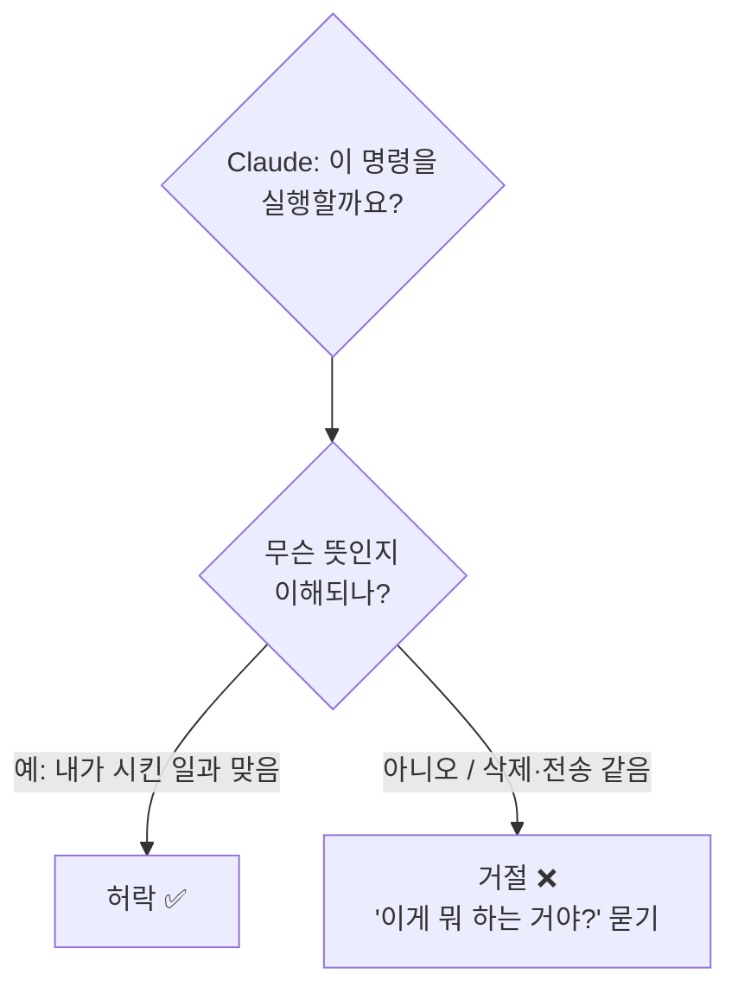

# 02. 화면 읽는 법

## 입력창 아래 한 줄만 보면 돼요
```
┌─────────────────────────────────────────────────────────────┐
│  여기에 할 일을 적고 Enter                                  │
├─────────────────────────────────────────────────────────────┤
│ [Local ▾]  [📁 workspace ▾]  [Auto ▾]              [모델 ▾] │
│   ①환경        ②작업 폴더        ③권한 모드         ④모델   │
└─────────────────────────────────────────────────────────────┘
```
| | 무엇 | 누나는 |
|---|---|---|
| ① 환경 | Claude가 어디서 일하나 | 항상 **Local** |
| ② 작업 폴더 | 어느 폴더에서 일하나 | 항상 **workspace** |
| ③ 권한 모드 | 얼마나 자주 허락을 묻나 | 아래 표 참고 |
| ④ 모델 | 어떤 Claude를 쓰나 | 건드리지 않기 |

## 권한 모드
| 모드 | 뜻 | 언제 |
|---|---|---|
| **Auto** | 거의 안 물음. 대신 **감시 모델이 매번 먼저 검사**해서 위험한 건 막음 | ✅ **평소** |
| **Plan** | 계획만 세우고 아무것도 안 바꿈 | 큰 작업 전에 "어떻게 할지"만 보고 싶을 때 |
| Manual · Accept edits | 자주 허락을 물음 | 동생이 옆에서 같이 볼 때 |
| **Bypass** | 검사 없이 전부 실행 | ❌ **절대 쓰지 않기** |

### Auto 모드가 알아서 막는 것
- 작업 전부터 있던 파일을 되돌릴 수 없게 지우기
- 민감한 정보를 외부로 보내기
- GitHub 기록 강제로 덮어쓰기
- 그리고 동생이 설정해 둔 금지 규칙 (`자료/` 수정, 파일 삭제 등)은 어떤 모드든 항상 막혀요

> 💡 Auto도 완벽하진 않아요. 결과물은 꼭 직접 확인하세요.
> 막힌 작업이 여러 번 반복되면 Auto가 잠시 멈추고 다시 허락을 물어요. 그때는 아래처럼 판단하면 돼요.

## 그래도 허락 요청이 뜨면

> 💡 모르겠으면 **거절하고 물어보면 돼요.** 거절해서 망가지는 건 없어요.

## 무시해도 되는 것
- 코드처럼 생긴 회색 글자, 터미널 출력
- `+12 -1` 같은 숫자 (바뀐 줄 수)
- 개발 관련 버튼들

## 알아 두면 좋은 단축키
| 키 | 기능 |
|---|---|
| **Enter** | 보내기 |
| **Shift+Enter** | 줄바꿈 |
| **Ctrl+N** | 새 작업 시작 |
| **Esc** | Claude 멈추기 |

📖 공식: [데스크톱 앱 사용법](https://code.claude.com/docs/en/desktop)
