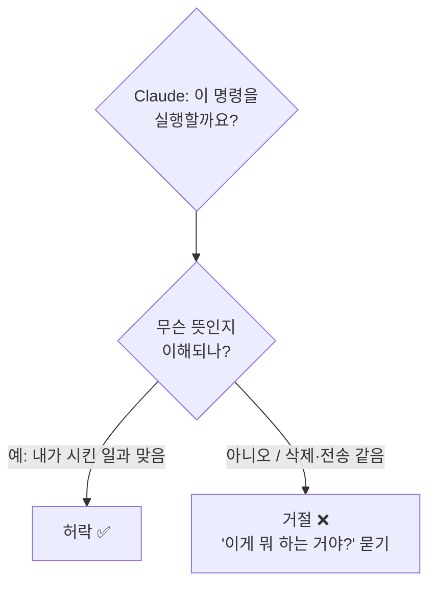

# 02. 화면 읽는 법

## 입력창 아래 한 줄만 보면 돼요
```
┌─────────────────────────────────────────────────────────────┐
│  여기에 할 일을 적고 Enter                                  │
├─────────────────────────────────────────────────────────────┤
│ [Local ▾]  [📁 workspace ▾]  [Accept edits ▾]      [모델 ▾] │
│   ①환경        ②작업 폴더        ③권한 모드         ④모델   │
└─────────────────────────────────────────────────────────────┘
```
| | 무엇 | 누나는 |
|---|---|---|
| ① 환경 | Claude가 어디서 일하나 | 항상 **Local** |
| ② 작업 폴더 | 어느 폴더에서 일하나 | 항상 **workspace** |
| ③ 권한 모드 | 얼마나 자주 허락을 묻나 | 아래 표 참고 |
| ④ 모델 | 어떤 Claude를 쓰나 | 건드리지 않기 |

## 권한 모드
| 모드 | 뜻 | 언제 |
|---|---|---|
| **Manual** | 파일 수정·명령마다 허락을 물음 | 처음 익힐 때 |
| **Accept edits** | 파일 수정은 알아서, 그 외 명령만 물음 | ✅ **평소** |
| **Plan** | 계획만 세우고 아무것도 안 바꿈 | 큰 작업 전에 "어떻게 할지"만 보고 싶을 때 |
| Auto / Bypass | 거의 안 물음 | ❌ **쓰지 않기** |

## 허락 요청이 뜨면

> 💡 모르겠으면 **거절하고 물어보면 돼요.** 거절해서 망가지는 건 없어요.

## 무시해도 되는 것
- 코드처럼 생긴 회색 글자, 터미널 출력
- `+12 -1` 같은 숫자 (바뀐 줄 수)
- 개발 관련 버튼들

## 알아 두면 좋은 단축키
| 키 | 기능 |
|---|---|
| **Enter** | 보내기 |
| **Shift+Enter** | 줄바꿈 |
| **Ctrl+N** | 새 작업 시작 |
| **Esc** | Claude 멈추기 |

📖 공식: [데스크톱 앱 사용법](https://code.claude.com/docs/en/desktop)
