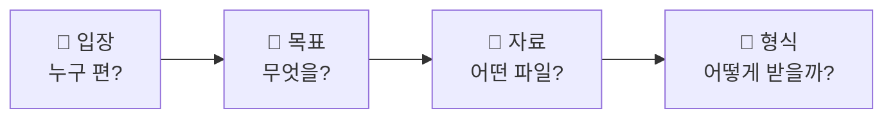

# 03. 첫 작업 맡기기

## 좋은 지시의 네 가지

| 요소 | 예 |
|---|---|
| **입장** | "우리는 매수인 측이야" |
| **목표** | "불리한 조항을 찾고 싶어" |
| **자료** | "`@자료/계약서.docx` 봐줘" |
| **형식** | "표로, `결과물/`에 Word로 저장" |

> 💡 **`@`를 치면 파일 목록이 떠요.** 골라서 넣으면 Claude가 정확히 그 파일을 봐요.

## 나쁜 예 vs 좋은 예
❌ "이 계약서 검토해줘"

✅ "우리는 **매수인 측**이야. `@자료/계약서.docx`에서 **매수인에게 불리한 조항**을 찾아서
조항 번호 · 문제점 · 수정 문구 제안을 **표로** 정리하고, `결과물/`에 Word로 저장해줘."

## 팁
- 뭘 말해야 할지 모르겠으면: **"이 작업을 하려면 나한테 뭘 물어봐야 해? 먼저 질문해줘"**
- 큰 작업은 권한 모드를 **Plan**으로 두고 "어떻게 할지 먼저 계획만 보여줘" → 괜찮으면 진행
