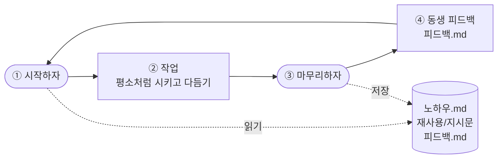
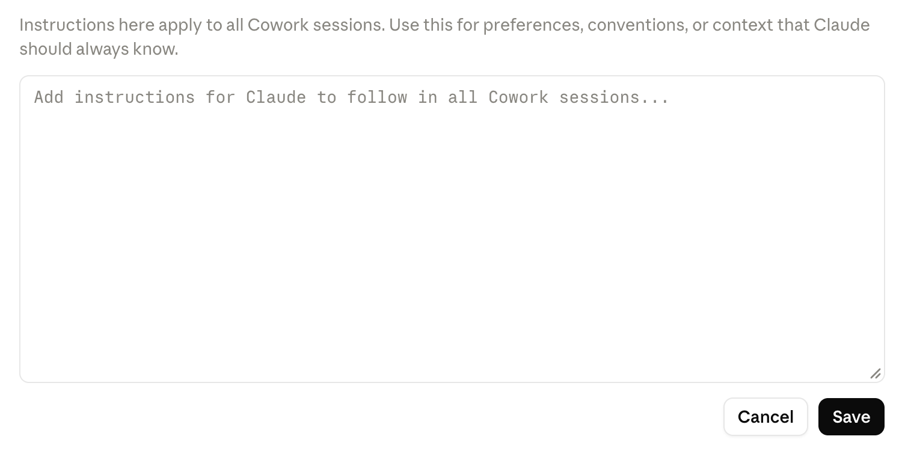

# 05. 작업 순환: 오늘 한 일을 다음에 다시 쓰기

Claude는 기본적으로 대화가 끝나면 잊어요. 그래서 **세 군데에 기억을 남겨요.**

| 기억 장소 | 누가 채우나 | 특징 |
|---|---|---|
| **프로젝트 메모리** | Claude가 자동으로 | 편하지만 내 PC에만 있고, 안을 들여다보기 어려움 |
| **폴더의 노하우·지시문** | "마무리하자" 하면 Claude가 | 파일이라 **동생도 보고 고칠 수 있음** |
| **스킬** | "스킬로 만들어줘" | 프로젝트 밖 모든 대화에서 자동 적용 |

## 한 바퀴 흐름
누나가 할 말은 딱 두 개예요: **"시작하자"**, **"마무리하자"**

### ① "시작하자"
Claude가 `노하우.md`, `피드백.md`를 읽고, `재사용/지시문/`에 **비슷한 작업이 있으면 먼저 알려 줘요.**
> 🤖 "지난번 내용증명 지시문이 있어요. 이걸로 시작할까요?"

### ② 작업
평소처럼 시키고 다듬어요. (02, 03편)

### ③ "마무리하자"
| 남기는 것 | 어디에 | 다음에 어떻게 쓰이나 |
|---|---|---|
| 작업일지 | `작업일지/` | 동생이 보고 피드백 |
| 새로 알게 된 요령 | `노하우.md` | 다음 시작 때 자동 반영 |
| 잘된 지시문 | `재사용/지시문/` | 비슷한 작업에서 그대로 재사용 |
| 잘된 결과 견본 (비식별) | `재사용/견본/` | "이 견본처럼 써줘" |

### ④ 피드백
동생이 `피드백.md`에 적으면, 다음 "시작하자" 때 Claude가 반영하고 `노하우.md`로 옮겨요. (06편)

## 한 단계 더: 스킬로 올리기

직접 하려면: **"방금 한 방식을 스킬로 만들어줘"**

📖 공식 안내: [스킬 사용하기](https://support.claude.com/ko/articles/12512180) · [대화로 스킬 만들기](https://support.claude.com/ko/articles/12599426)

## 처음 한 번만: 전체 지침 설정
**Settings › Cowork**의 전체 지침(Global instructions)에 아래 한 줄을 넣어 두면, 어느 작업이든 이 습관을 지켜요.

*출처: Claude 고객센터, [Get started with Claude Cowork](https://support.claude.com/en/articles/13345190)*

> 작업을 시작하면 노하우.md와 피드백.md를 먼저 읽고, 작업이 끝나면 일지·노하우·지시문을 남긴다.
