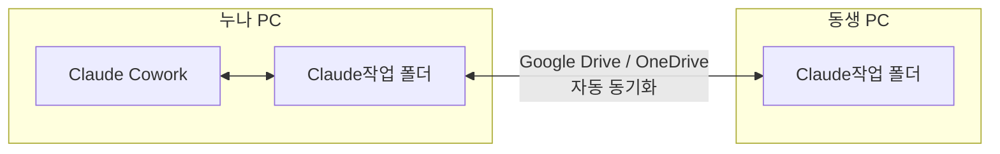
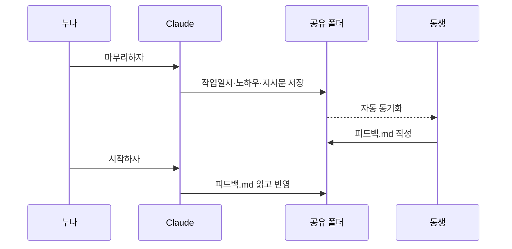

# 06. 피드백 주고받기

## 왜 공유 폴더인가

- Cowork **프로젝트(지침·메모리)는 누나 PC에만** 저장돼요. 동생이 볼 수 없어요.
- 대신 **폴더의 파일**(작업일지, 결과물, 노하우)은 공유 폴더로 동생도 볼 수 있어요.

## 흐름


## 피드백.md 쓰는 법 (동생용)
```
## 2026-11-20 내용증명 초안
- 요구사항을 맨 앞에 두라고 지시하면 더 좋음
- 기한은 "도달일로부터 7일 이내"처럼 구체적으로
상태: 미반영
```
Claude가 반영하면 `상태: 반영됨`으로 바꾸고, 계속 쓸 요령은 `노하우.md`로 옮겨요.

## ⚠️
이 폴더는 동생도 보게 돼요. **비식별화한 작업, 연습 작업만** 이 폴더에서 하세요.
실제 사건은 **별도 프로젝트·별도 폴더**에서 하고, 궁금한 점은 **방식만** 말로 물어보세요.
