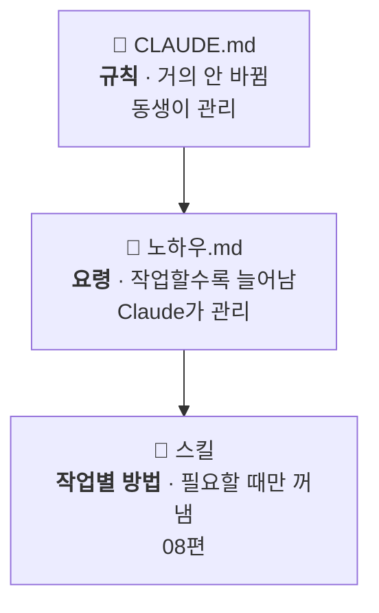

# 07. CLAUDE.md 이해하기

## 한 줄 정의
**`CLAUDE.md`는 Claude가 작업 폴더를 열 때마다 제일 먼저 읽는 "업무 지시서"예요.**

신입이 출근하면 책상 위에 놓인 **업무 매뉴얼**을 먼저 읽는 것과 같아요.
매번 "사본만 써", "개인정보 조심해"라고 말할 필요가 없어요.

## 무엇이 들어 있나 (우리 폴더 기준)
| 부분 | 내용 |
|---|---|
| 시작하자 | 최신 내용 받기 → 노하우·피드백 읽기 → 비슷한 지시문 찾기 |
| 작업 중 | `자료/`는 읽기만, 결과는 `결과물/`, 판례·숫자는 "원문 확인 필요" |
| 마무리하자 | 일지·노하우·지시문 저장 → GitHub에 올리기 |

## 노하우.md와 뭐가 달라요?

## 누나가 할 일
- **직접 고칠 필요 없어요.** 바꾸고 싶은 게 있으면 말로 하면 돼요:
  > "앞으로 결과물 파일 이름에 사건 번호 말고 날짜만 넣어줘. CLAUDE.md에도 적어줘."
- 큰 규칙 변경은 동생과 상의하세요. 동생이 GitHub에서 고치면 다음 "시작하자" 때 반영돼요.

📖 공식: [CLAUDE.md와 메모리](https://code.claude.com/docs/en/memory)
