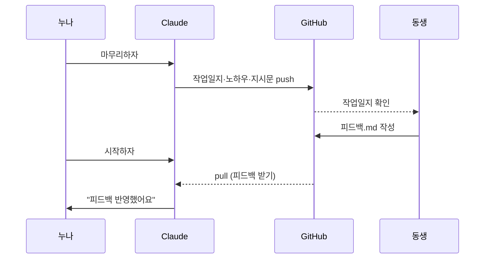

# 07. 피드백 주고받기



## 동생이 보는 것
- `작업일지/`: 어떻게 시켰고 무엇이 잘 안 됐는지
- `노하우.md`, `재사용/`, `.claude/skills/`: 쌓이고 있는 요령
- ❌ 실제 파일(`자료/`, `결과물/`)은 GitHub에 없어서 **볼 수 없어요** (그게 맞아요)

## 피드백.md 쓰는 법 (동생용)
```
## 2026-11-20 내용증명 초안
- 요구사항을 맨 앞에 두라고 지시하면 더 좋음
- 기한은 "도달일로부터 7일 이내"처럼 구체적으로
상태: 미반영
```
Claude가 반영하면 `상태: 반영됨`으로 바꾸고, 계속 쓸 요령은 `노하우.md`로 옮겨요.

## 동생이 더 깊게 도와줄 때
동생은 같은 저장소를 자기 PC에서 열어 `CLAUDE.md`나 스킬을 **직접 고쳐서 push**할 수 있어요.
누나가 다음에 "시작하자" 하면 바로 적용돼요.
