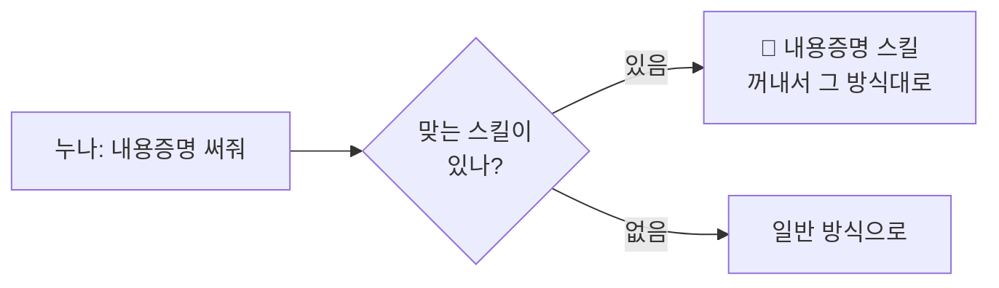
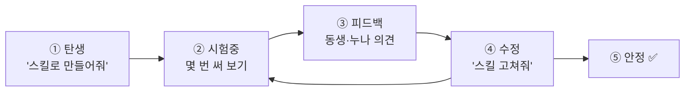
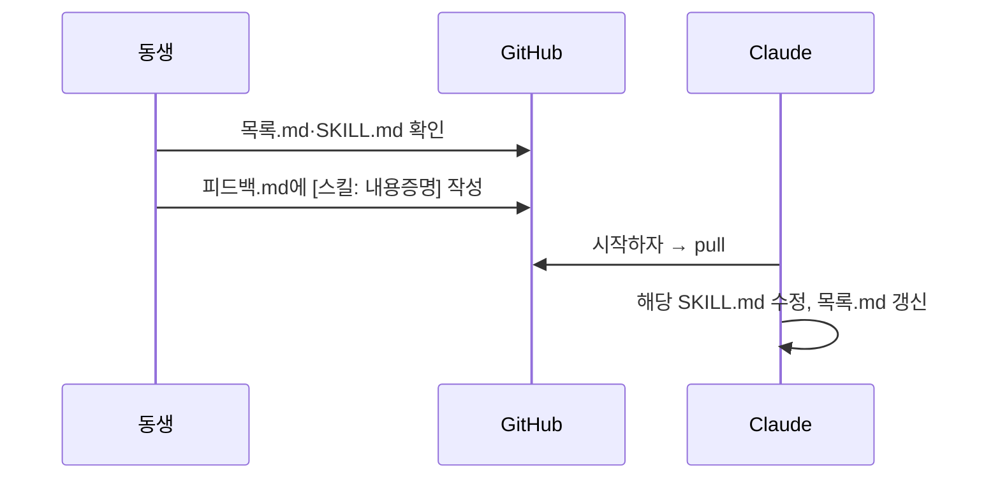

# 08. 스킬 관리

## 스킬이란?
**특정 작업을 잘하는 방법을 적어 둔 "작업 매뉴얼 한 장"**이에요.
`CLAUDE.md`가 늘 읽는 업무 지시서라면, 스킬은 **그 작업을 할 때만 꺼내 보는 매뉴얼**이에요.



## 스킬은 어디에 있나
```
workspace/.claude/skills/
├── 목록.md                ← 스킬 한눈에 보기 (Claude가 관리)
├── 내용증명/
│   └── SKILL.md           ← 매뉴얼 본문
├── 판결문-요약/
│   └── SKILL.md
└── 거래내역-정리/
    └── SKILL.md
```

## SKILL.md 생김새
```markdown
---
name: 내용증명
description: 내용증명 초안을 쓸 때 사용. 요구사항·기한·법적 근거 구조로 작성.
---

1. 요구사항을 첫 문단에 쓴다.
2. 기한은 "도달일로부터 7일 이내"처럼 구체적으로.
3. 법적 근거는 조문만 쓰고 "원문 확인 필요" 표시.
4. 정중하지만 단호한 어조.
```
- **description**이 제일 중요해요. Claude는 이걸 보고 "지금 이 스킬을 꺼낼까?"를 판단해요.

## 스킬의 일생


## 누나가 쓰는 말
| 하고 싶은 것 | 이렇게 말하기 |
|---|---|
| 만들기 | "방금 한 방식을 스킬로 만들어줘" |
| 목록 보기 | "스킬 목록 보여줘" |
| 꼭 쓰게 하기 | "내용증명 스킬로 써줘" 또는 `/` 치고 스킬 고르기 |
| 고치기 | "내용증명 스킬에 '기한은 7일'을 추가해줘" |
| 없애기 | "이 스킬은 이제 안 써. 지워줘" |

## 목록.md (Claude가 자동으로 관리)
| 스킬 | 용도 | 상태 | 최근 수정 | 메모 |
|---|---|---|---|---|
| 내용증명 | 내용증명 초안 | ✅ 안정 | 2026-11-20 | 피드백 2회 반영 |
| 판결문-요약 | 판결문 한 장 요약 | 🧪 시험중 | 2026-11-22 | |

## 동생이 피드백 주는 법

피드백.md 예시:
```
## [스킬: 내용증명] 2026-11-21
- 마지막에 "회신이 없으면 법적 조치" 문단을 선택 사항으로 추가
상태: 미반영
```
동생이 `SKILL.md`를 **직접 고쳐서 push**해도 돼요.

📖 공식: [스킬](https://code.claude.com/docs/en/skills)
