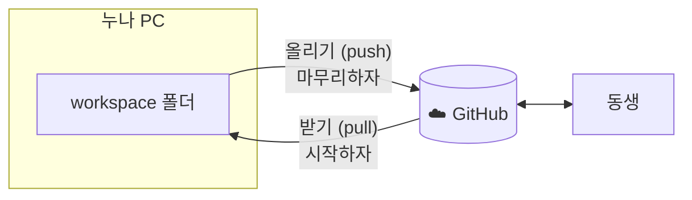

# 09. GitHub 최소한만

## GitHub란?
**작업 기록을 보관하고 동생과 주고받는 온라인 금고**예요.
누나는 거의 직접 쓰지 않아요. **Claude가 대신 올리고 받아요.**



## 알아야 할 단어 세 개뿐
| 단어 | 뜻 | 누가 |
|---|---|---|
| **저장소** | GitHub에 있는 폴더 | — |
| **push (올리기)** | 내 PC → GitHub | "마무리하자" 할 때 Claude가 |
| **pull (받기)** | GitHub → 내 PC | "시작하자" 할 때 Claude가 |

## 누나가 직접 할 일
1. **강의 보기**: 브라우저에서 `github.com/gyuber/claude-basics` (즐겨찾기)
2. **작업 기록 보기** (선택): 작업 저장소의 `작업일지/`, `피드백.md` 클릭해서 읽기
3. 그게 전부예요.

## GitHub 웹에서 파일 읽는 법
```
github.com/gyuber/claude-basics
┌──────────────────────────────────────────┐
│ 📁 lessons                               │ ← 클릭하면 강의 목록
│ 📁 workspace-템플릿                       │
│ 📄 README.md                              │
├──────────────────────────────────────────┤
│  (아래에 README 내용이 바로 보임)          │
└──────────────────────────────────────────┘
```
- 폴더 클릭 → 파일 클릭 → 내용이 그림과 함께 보여요.
- 뒤로 가기는 브라우저 뒤로 가기 버튼.

## 이런 메시지가 보이면
| Claude가 말하면 | 뜻 | 할 일 |
|---|---|---|
| "올리기 실패" | 인터넷이나 로그인 문제 | 동생에게 연락. 작업은 PC에 안전하게 남아 있음 |
| "충돌이 있어요" | 동생과 같은 파일을 동시에 고침 | 아무것도 누르지 말고 동생에게 연락 |
