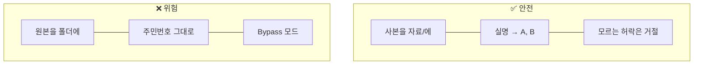

# 08. 꼭 지킬 것

1. **인용·숫자는 원문으로 확인**
   판례 번호, 조문, 출처, 계산 결과를 그럴듯하게 틀릴 수 있어요. 원문 확인 전에는 쓰지 마세요.
2. **원본은 넣지 않기**
   Claude는 파일을 고칠 수 있어요. 항상 **사본**을 `자료/`에 넣으세요.
3. **민감한 정보는 지우기**
   실명, 주민번호, 연락처는 A·B로 바꾸거나 지우세요.
4. **일지·노하우에 사건 내용 적지 않기**
   이 파일들은 GitHub에 올라가고 동생도 봐요. **방식만** 적고, 사건 내용은 적지 않아요.
5. **평소엔 Auto, Bypass는 절대 금지**
   Auto는 감시 모델이 위험한 걸 막아 줘요. 그래도 허락 요청이 뜨는데 모르겠으면 거절하고 "이게 뭐 하는 거야?"라고 물으면 돼요.
6. **최종 판단은 내가**
   Claude는 초안까지만. 책임은 사람에게 있어요.
