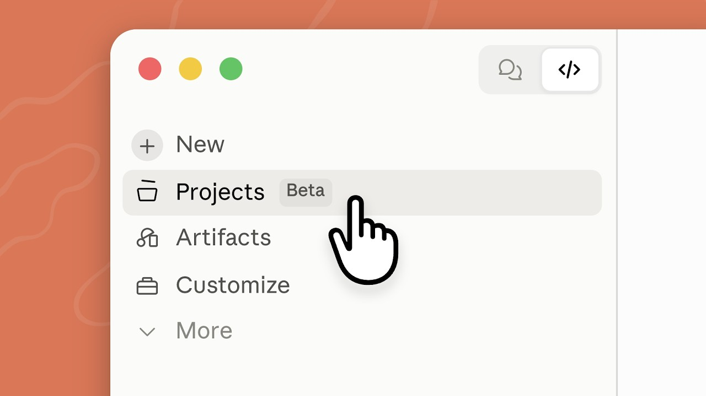
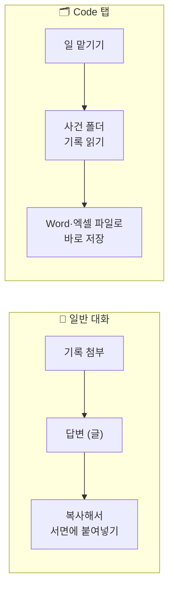
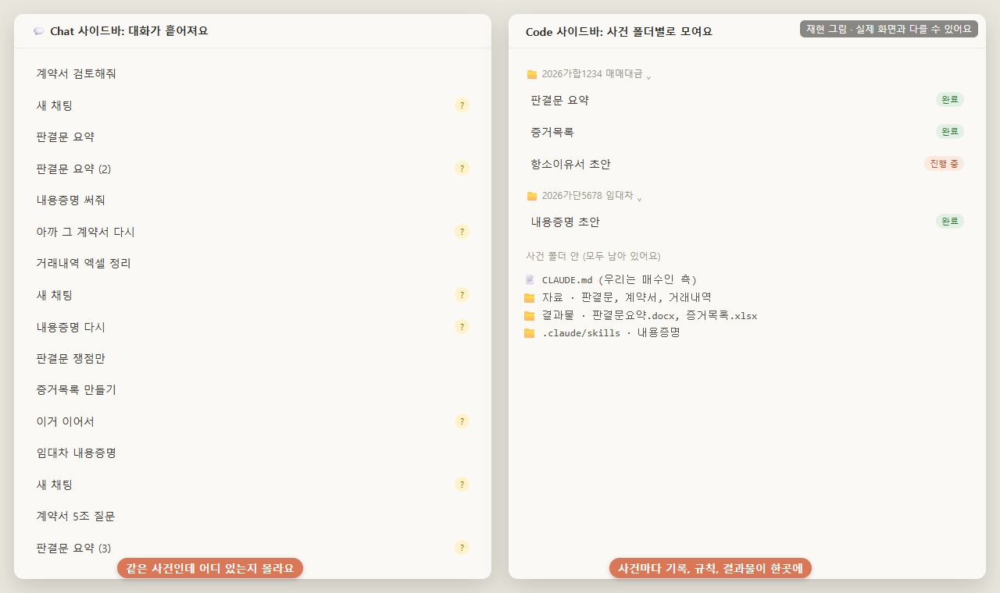
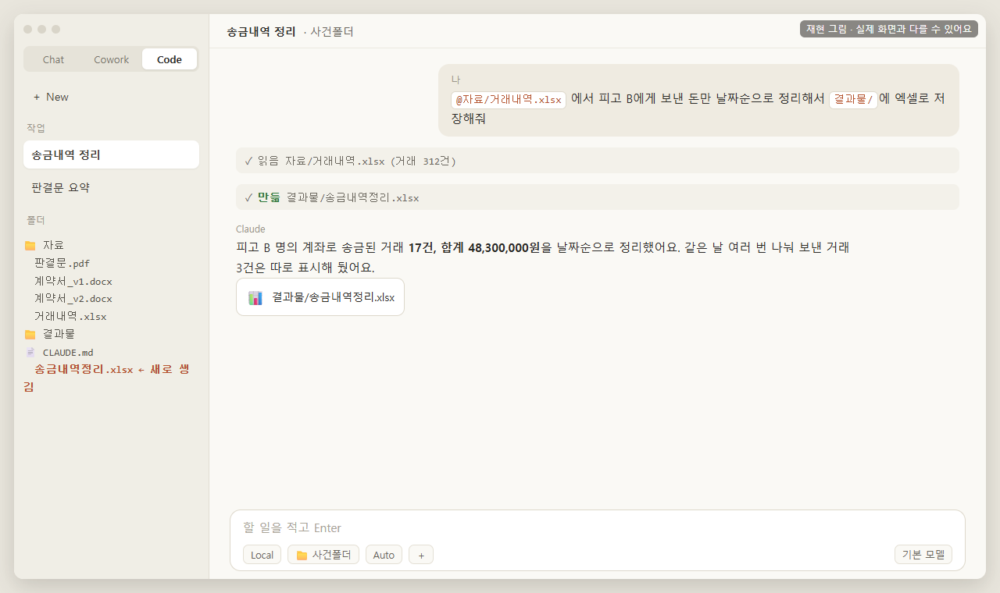

# 00. Claude Code란

## 한 줄 정의
Claude 데스크톱 앱의 **Code 탭**이에요. **내 PC 폴더 안의 파일을 직접 읽고, 고치고, 새로 만드는** Claude입니다.
원래 개발자용이지만 판결문, 계약서, 거래내역 같은 **사건 기록 작업**에 그대로 쓸 수 있어요.

## 앱에서 Code 탭 찾기
Claude 데스크톱 앱에는 **Chat, Cowork, Code** 세 가지 방식이 있어요.

*출처: Claude Academy, [Navigating the Claude desktop app](https://claude.com/resources/tutorials/navigating-the-claude-desktop-app)*

앱 왼쪽 위의 **`</>` 버튼**이 Code예요. 말풍선 버튼은 일반 대화(Chat)입니다.

*출처: Claude 공식 유튜브, [Getting started with Claude Code Projects](https://www.youtube.com/watch?v=omihvjf0A2k)*

## 일반 대화와 무엇이 다른가

| | 일반 대화 | Code 탭 |
|---|---|---|
| 기록 | 파일을 하나씩 첨부 | **사건 폴더째로** 읽고 저장 |
| 지침 | 매번 "우리는 원고 측이야" 설명 | `CLAUDE.md`에 한 번 써 두면 **자동으로 읽음** (07편) |
| 반복 업무 | 매번 다시 설명 | 내용증명, 판결문 요약을 **스킬**로 재사용 (08편) |

## 왜 Chat보다 Code가 나은가
Chat으로 사건 일을 하다 보면 **대화만 계속 늘어나요.** "새 채팅", "판결문 요약 (2)", "아까 그 계약서 다시"처럼 같은 사건 대화가 여기저기 흩어지고, 어디서 무엇을 했는지 찾기 어려워요.
Code 탭은 **사건 폴더가 중심**이라 작업을 여러 번 열어도 그 사건 폴더 아래로 모여요.

*재현 그림: 흩어지는 Chat 대화와 사건 폴더별로 모이는 Code 작업*

| | 💬 Chat | 🗂️ Code |
|---|---|---|
| 대화 목록 | 날짜순으로 **계속 쌓이고 흩어짐** | **사건 폴더별로 묶임** |
| 기록 파일 | 대화마다 **다시 첨부** | 사건 폴더에 **한 번** 넣으면 끝 |
| "우리는 매수인 측" 같은 설명 | 새 대화마다 **다시** | `CLAUDE.md`에 **한 번** |
| 결과물 | 답변 속 글, **복사해서 저장** | `결과물/`에 **파일로 남음** |
| 어제 한 일 이어 하기 | 그 대화를 **찾아야** 함 | 같은 폴더면 **새 작업이어도** 기록·규칙·결과물이 다 있음 |
| 잘된 방식 | 대화 속에 묻힘 | **스킬**로 남겨 재사용 |

### 예시: 같은 사건을 사흘 동안

| | 💬 Chat으로 하면 | 🗂️ Code로 하면 |
|---|---|---|
| 월요일 | 새 채팅, 판결문 첨부, "우리는 원고 측이야" 설명, 요약 복사 | 사건 폴더 선택, "판결문 요약해서 결과물에 저장해줘" |
| 화요일 | 새 채팅, 판결문과 계약서 **다시 첨부**, 입장 **다시 설명** | 같은 폴더에서 "어제 요약 보고 증거목록 만들어줘" |
| 수요일 | "월요일 그 대화 어디 있지?" **검색**, 결과 다시 모으기 | `결과물/`에 요약, 증거목록이 그대로, "이걸로 준비서면 초안" |

> **🙋 나** (수요일, 같은 사건 폴더에서 새 작업) `결과물/`의 판결문 요약이랑 증거목록 보고 준비서면 초안 써줘
>
> **🤖 Claude** `결과물/2026-11-17 판결문 요약.docx`와 `결과물/증거목록.xlsx`를 읽었어요. CLAUDE.md대로 원고 측 입장에서 준비서면 초안을 써서 `결과물/2026-11-19 준비서면 초안.docx`로 저장했어요.

> 💡 그래서 **간단한 질문은 Chat**, **사건 기록으로 하는 일은 Code**로 나눠 쓰면 좋아요.

## 예시: 송금 내역 정리를 한 마디로
**할 일**: 계좌 거래내역 312건 중 피고에게 보낸 돈만 골라 엑셀로 정리하기

*재현 그림: Code 탭에 한 마디로 시키면 결과물 폴더에 엑셀 파일이 생겨요*

> **🙋 나** `@자료/거래내역.xlsx` 에서 피고 B에게 보낸 돈만 날짜순으로 정리해서 `결과물/`에 엑셀로 저장해줘
>
> **🤖 Claude** 피고 B 명의 계좌로 송금된 거래 17건, 합계 48,300,000원을 날짜순으로 정리했어요. 같은 날 나눠 보낸 거래 3건은 따로 표시했어요. `결과물/송금내역정리.xlsx`

일반 대화였다면 엑셀을 첨부하고, 답으로 나온 표를 복사해서, 새 엑셀에 붙여넣고 저장까지 직접 해야 해요.

*💬 예시 대화와 재현 그림은 이해를 돕기 위해 만든 것이에요. 사건, 이름, 숫자는 모두 가상이고 실제 답은 조금 다를 수 있어요.*

## 기억할 것
- 코딩은 몰라도 돼요. **평소 말로** 시키면 됩니다.
- Claude는 **빠르고 성실한 신입 어쏘**예요. 맥락을 잘 주고, 결과는 꼭 검토하세요.

📖 공식: [데스크톱 앱의 Claude Code](https://code.claude.com/docs/en/desktop)
