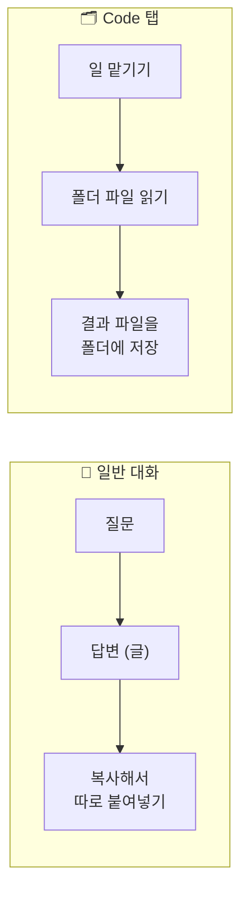

# 00. Claude Code란

## 한 줄 정의
Claude 데스크톱 앱의 **Code 탭**이에요. **내 PC 폴더 안의 파일을 직접 읽고, 고치고, 새로 만드는** Claude입니다.
원래 개발자용이지만 Word·엑셀·PDF 같은 문서 작업에도 그대로 쓸 수 있어요.

## 앱에서 Code 탭 찾기
Claude 데스크톱 앱에는 **Chat, Cowork, Code** 세 가지 방식이 있어요.


*출처: Claude Academy, [Navigating the Claude desktop app](https://claude.com/resources/tutorials/navigating-the-claude-desktop-app)*

앱 왼쪽 위의 **`</>` 버튼**이 Code예요. 말풍선 버튼은 일반 대화(Chat)입니다.


*출처: Claude 공식 유튜브, [Getting started with Claude Code Projects](https://www.youtube.com/watch?v=omihvjf0A2k)*

## 일반 대화와 무엇이 다른가


| | 일반 대화 | Code 탭 |
|---|---|---|
| 파일 | 하나씩 첨부 | **폴더째로** 읽고 저장 |
| 지침 | 매번 설명 | `CLAUDE.md`에 한 번 써 두면 **자동으로 읽음** (07편) |
| 반복 작업 | 매번 다시 설명 | **스킬**로 저장해 두고 재사용 (08편) |

## 기억할 것
- 코딩은 몰라도 돼요. **평소 말로** 시키면 됩니다.
- Claude는 **빠르고 성실한 신입**이에요. 맥락을 잘 주고, 결과는 꼭 검토하세요.

## 예시: 같은 일을 두 방식으로
**할 일**: 거래내역 엑셀에서 월별 합계를 내서 엑셀 파일로 받기

**일반 대화로 하면**
1. 엑셀 파일을 첨부하고 "월별 합계 내줘"
2. 답변에 표가 글로 나옴
3. 표를 복사해서 엑셀을 새로 열고 붙여넣기, 칸 정리, 저장

**Code 탭으로 하면**
> **🙋 나** `@자료/거래내역.xlsx` 월별 합계 내서 `결과물/`에 엑셀로 저장해줘
>
> **🤖 Claude** 거래내역 312건을 읽었어요. 1월부터 6월까지 월별 입금·출금 합계를 계산해서 `결과물/월별합계.xlsx`로 저장했어요. 6월 출금이 다른 달보다 3배 많아서 표에 따로 표시해 뒀어요.

폴더가 이렇게 바뀌어요.
```
작업폴더/
├── 자료/
│   └── 거래내역.xlsx
└── 결과물/
    └── 월별합계.xlsx    ← 새로 생김
```

*💬 예시 대화는 이해를 돕기 위해 만든 것이에요. 실제 Claude의 답은 문장이 조금 다를 수 있어요.*

📖 공식: [데스크톱 앱의 Claude Code](https://code.claude.com/docs/en/desktop)
