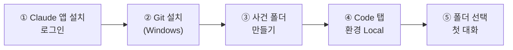
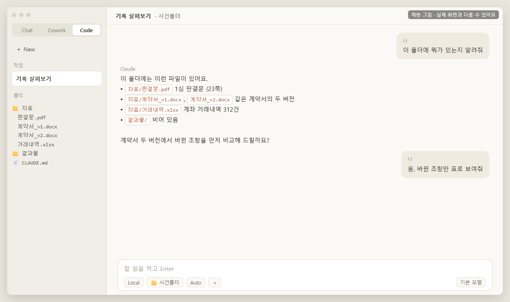

# 01. 시작 준비



| 단계 | 할 일 |
|---|---|
| ① | [Claude 데스크톱 앱](https://claude.ai/download)을 설치하고 로그인 (유료 요금제 필요) |
| ② | Windows는 [Git](https://git-scm.com/downloads)을 먼저 설치. Code 탭이 내부적으로 써요 |
| ③ | 사건마다 작업 폴더를 하나 만들기 (아래 구조) |
| ④ | 앱에서 Code 탭(`</>`) → 입력창 아래 환경을 **Local**로 |
| ⑤ | 폴더 버튼으로 ③의 폴더 선택 → "이 폴더에 뭐가 있는지 알려줘" |

## 사건 폴더 만드는 요령
```
2026가합1234_매매대금/
├── 자료/      ← 기록 "사본" (판결문, 계약서, 거래내역, 진술서)
├── 결과물/    ← Claude가 만든 서면 초안, 표, 요약
└── CLAUDE.md  ← 이 사건 규칙 (07편)
```
- **원본 기록은 넣지 마세요.** Claude는 폴더 안 파일을 고칠 수 있어요. 항상 사본으로 작업해요.
- 사건마다 폴더를 따로 두면 다른 사건 기록이 섞이지 않아요.

## 예시: 첫 대화

*재현 그림: 폴더를 고르고 무엇이 있는지 먼저 물어보기*

> **🙋 나** 이 폴더에 뭐가 있는지 알려줘
>
> **🤖 Claude** 이런 파일이 있어요.
> - `자료/판결문.pdf` 1심 판결문 (23쪽)
> - `자료/계약서_v1.docx`, `계약서_v2.docx` 같은 계약서의 두 버전
> - `자료/거래내역.xlsx` 계좌 거래내역 312건
> - `결과물/` 비어 있음
>
> 계약서 두 버전에서 바뀐 조항을 먼저 비교해 드릴까요?

> **🙋 나** 응, 바뀐 조항만 표로 보여줘

폴더 안을 먼저 보여 달라고 하면 Claude가 기록 전체를 알고 시작해서, 엉뚱한 파일을 볼 일이 줄어요.

*💬 예시 대화와 재현 그림은 이해를 돕기 위해 만든 것이에요. 사건, 이름, 숫자는 모두 가상이고 실제 답은 조금 다를 수 있어요.*

📖 공식: [Windows에서 시작하기](https://code.claude.com/docs/en/desktop-quickstart)
