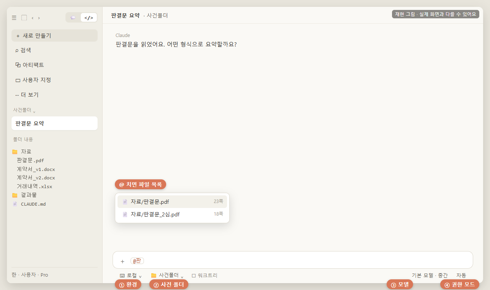

# 02. 화면 읽기

## 실제 화면은 이렇게 생겼어요
처음 보면 복잡해 보이지만, 코드·터미널 칸은 **개발자용이라 무시해도 돼요.**
볼 곳은 **대화 내용**과 **맨 아래 입력창 한 줄**뿐이에요.

*출처: Claude 공식 유튜브, [The new Claude Code desktop app](https://www.youtube.com/watch?v=rWaQSQEm_aY). 개발 작업 예시라 코드가 많아요. 사건 기록 작업에서는 파일 이름과 대화가 주로 보여요.*

## 입력창 아래 한 줄

*재현 그림: 입력창 아래 네 칸과 @ 파일 목록*

| | 무엇 | 보통 |
|---|---|---|
| ① 환경 | Claude가 어디서 일하나 | 내 PC (Windows 앱에서는 **로컬**, WSL을 쓰면 **Ubuntu**) |
| ② 사건 폴더 | 어느 사건 폴더에서 일하나 | 그 사건 폴더 |
| ③ 모델 | 어떤 Claude를 쓰나 (옆의 "중간"은 생각하는 정도) | 기본값 그대로 |
| ④ 권한 모드 | 얼마나 자주 허락을 묻나 | **자동** (03편) |

가운데 **워크트리** 칸은 개발자용이라 꺼 두면 돼요. 오른쪽 위 목록 버튼을 누르면 **환경, 폴더, 컨텍스트(대화가 얼마나 찼는지)**를 볼 수 있어요.

## 무시해도 되는 것
- 코드처럼 생긴 회색 글자, 터미널 출력
- `+12 -1` 같은 숫자 (바뀐 줄 수)
- 개발 관련 버튼과 패널

## 손에 익힐 키

| 키 | 기능 |
|---|---|
| **Enter** | 보내기 |
| **Shift+Enter** | 줄바꿈 |
| **@** | 기록 파일 고르기 (목록이 떠요) |
| **/** | 명령·스킬 목록 |
| **Ctrl+N** | 새 작업 |
| **Esc** | Claude 멈추기 |

## 예시: 이럴 땐 이렇게
**판결문 요약이 엉뚱하게 길어질 때**: **Esc**로 멈추고 바로 다시 말하기
> **🙋 나** (Esc) 멈춰. 전체 요약 말고 쟁점만 세 줄로

**정확히 그 기록만 보게 하고 싶을 때**: `@판`까지 치면 `판결문.pdf`, `판결문_2심.pdf`처럼 이름이 맞는 파일만 남아요.
> **🙋 나** `@자료/판결문_2심.pdf` 에서 1심과 판단이 달라진 부분만 알려줘

**다른 사건 일을 하려면**: **Ctrl+N**으로 새 작업을 열고, 폴더도 그 사건 폴더로 바꾸세요.

*💬 예시 대화와 재현 그림은 이해를 돕기 위해 만든 것이에요. 사건, 이름, 숫자는 모두 가상이고 실제 답은 조금 다를 수 있어요.*

📖 공식: [데스크톱 앱 사용법](https://code.claude.com/docs/en/desktop)
