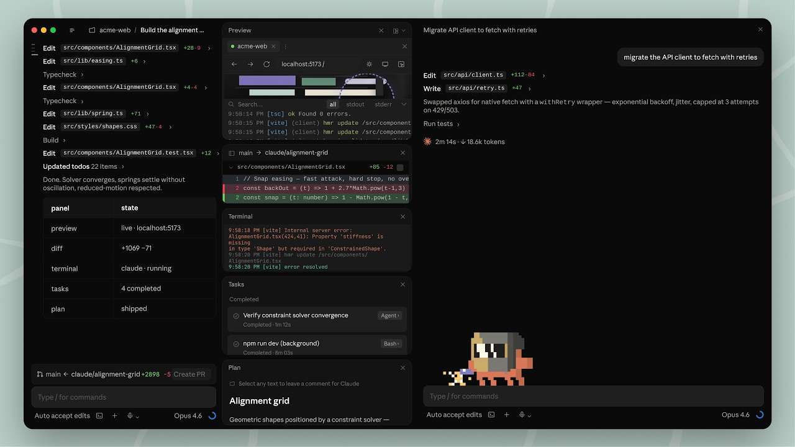

# 02. 화면 읽기

## 실제 화면은 이렇게 생겼어요
처음 보면 복잡해 보이지만, 코드·터미널 칸은 **개발자용이라 무시해도 돼요.**
볼 곳은 **대화 내용**과 **맨 아래 입력창 한 줄**뿐이에요.


*출처: Claude 공식 유튜브, [The new Claude Code desktop app](https://www.youtube.com/watch?v=rWaQSQEm_aY). 개발 작업 예시라 코드가 많아요. 문서 작업에서는 파일 이름과 대화가 주로 보여요.*

## 입력창 아래 한 줄
```
┌─────────────────────────────────────────────────────────────┐
│  여기에 할 일을 적고 Enter                                  │
├─────────────────────────────────────────────────────────────┤
│ [Local ▾]  [📁 작업폴더 ▾]  [Auto ▾]               [모델 ▾] │
│   ①환경        ②작업 폴더      ③권한 모드          ④모델    │
└─────────────────────────────────────────────────────────────┘
```
| | 무엇 | 보통 |
|---|---|---|
| ① 환경 | Claude가 어디서 일하나 | **Local** (내 PC) |
| ② 작업 폴더 | 어느 폴더에서 일하나 | 작업 폴더 |
| ③ 권한 모드 | 얼마나 자주 허락을 묻나 | **Auto** (03편) |
| ④ 모델 | 어떤 Claude를 쓰나 | 기본값 그대로 |

## 무시해도 되는 것
- 코드처럼 생긴 회색 글자, 터미널 출력
- `+12 -1` 같은 숫자 (바뀐 줄 수)
- 개발 관련 버튼과 패널

## 손에 익힐 키
| 키 | 기능 |
|---|---|
| **Enter** | 보내기 |
| **Shift+Enter** | 줄바꿈 |
| **@** | 파일 고르기 (목록이 떠요) |
| **/** | 명령·스킬 목록 |
| **Ctrl+N** | 새 작업 |
| **Esc** | Claude 멈추기 |

📖 공식: [데스크톱 앱 사용법](https://code.claude.com/docs/en/desktop)
