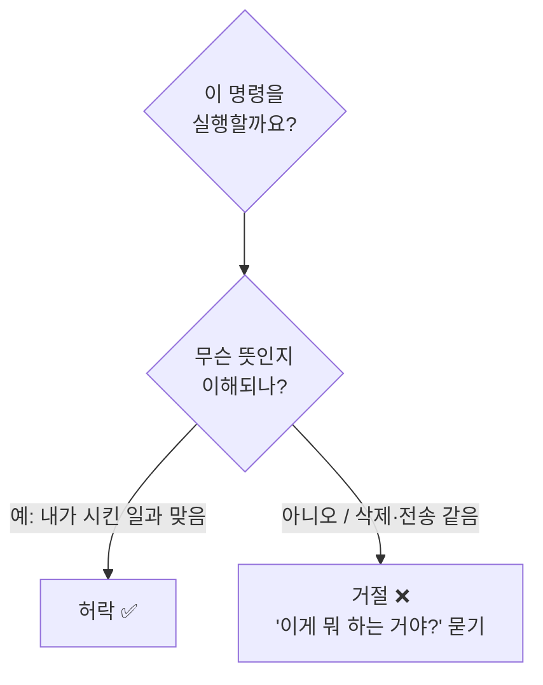

# 03. 권한 모드

Claude가 파일을 고치거나 명령을 실행하기 전에 **얼마나 자주 허락을 물을지** 정하는 설정이에요.

| 모드 | 뜻 | 언제 |
|---|---|---|
| **Auto** | 거의 안 물음. 대신 **감시 모델이 매번 먼저 검사**해서 위험한 건 막음 | ✅ **평소** |
| **Plan** | 계획만 세우고 아무것도 안 바꿈 | 큰 작업 전에 "어떻게 할지"만 볼 때 |
| Manual · Accept edits | 자주 허락을 물음 | 하나하나 확인하고 싶을 때 |
| **Bypass** | 검사 없이 전부 실행 | ❌ **쓰지 않기** |

## Auto가 알아서 막는 것 (공식 기준)
- 작업 전부터 있던 파일을 되돌릴 수 없게 지우기
- 민감한 정보를 외부로 보내기
- 인터넷에서 받은 프로그램 실행
- GitHub 기록 강제로 덮어쓰기

> 💡 Auto도 완벽하진 않아요. **결과물은 꼭 직접 확인**하세요.
> 막히는 작업이 여러 번 반복되면 Auto가 잠시 멈추고 다시 허락을 물어요.

## Auto를 기본값으로 하려면
`C:\Users\<사용자>\.claude\settings.json` 에 넣어요. (작업 폴더 설정에 넣으면 적용되지 않아요)
```json
{ "permissions": { "defaultMode": "auto" } }
```

## 그래도 허락 요청이 뜨면

> 💡 모르겠으면 **거절하고 물어보면 돼요.** 거절해서 망가지는 건 없어요.

📖 공식: [권한 모드](https://code.claude.com/docs/en/permission-modes)
