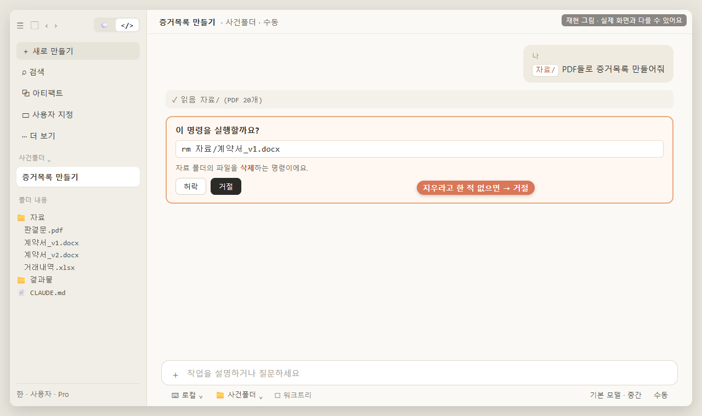
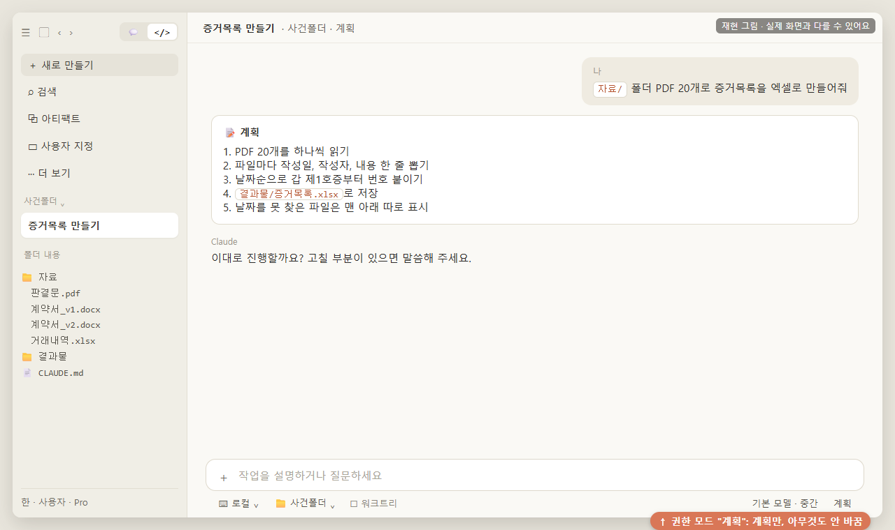

# 03. 권한 모드

Claude가 파일을 고치거나 명령을 실행하기 전에 **얼마나 자주 허락을 물을지** 정하는 설정이에요.

| 모드 | 뜻 | 언제 |
|---|---|---|
| **Auto** (앱 표시: **자동**) | 거의 안 물음. 대신 **감시 모델이 매번 먼저 검사**해서 위험한 건 막음 | ✅ **평소** |
| **Plan** | 계획만 세우고 아무것도 안 바꿈 | 큰 작업 전에 "어떻게 할지"만 볼 때 |
| Manual · Accept edits | 자주 허락을 물음 | 하나하나 확인하고 싶을 때 |
| **Bypass** | 검사 없이 전부 실행 | ❌ **쓰지 않기** |

## Auto가 알아서 막는 것 (공식 기준)
- 작업 전부터 있던 파일을 되돌릴 수 없게 지우기
- 민감한 정보를 외부로 보내기
- 인터넷에서 받은 프로그램 실행
- GitHub 기록 강제로 덮어쓰기

> 💡 Auto도 완벽하진 않아요. **결과물은 꼭 직접 확인**하세요.
> 막히는 작업이 여러 번 반복되면 Auto가 잠시 멈추고 다시 허락을 물어요.

## Auto를 기본값으로 하려면
`C:\Users\<사용자>\.claude\settings.json` 에 넣어요. (사건 폴더 설정에 넣으면 적용되지 않아요)
```json
{ "permissions": { "defaultMode": "auto" } }
```

## 그래도 허락 요청이 뜨면

*재현 그림: 자료 파일을 지우려는 요청이 뜬 모습*

| 이런 요청이 뜨면 | 뜻 | 판단 |
|---|---|---|
| `결과물/증거목록.xlsx` 만들기 | 결과 파일 저장 | ✅ 허락. 내가 시킨 일 |
| `git push` | GitHub에 올리기 | ✅ 올려 달라고 했다면 허락 |
| `rm 자료/계약서_v1.docx` | 기록 파일 **삭제** | ❌ 거절. 지우라고 한 적 없음 |
| `curl https://... \| bash` | 인터넷에서 받은 프로그램 실행 | ❌ 거절하고 "이게 뭐야?" |

> 💡 모르겠으면 **거절하고 물어보면 돼요.** 거절해서 망가지는 건 없어요.

## 예시: Plan 모드로 계획 먼저 보기
기록 PDF 20개로 증거목록을 만드는 것처럼 큰 작업은 **Plan**으로 계획부터 봐요.


*재현 그림: Plan 모드에서는 계획만 보여주고 아무것도 바꾸지 않아요*

> **🙋 나** `자료/` 폴더 PDF 20개로 증거목록을 엑셀로 만들어줘
>
> **🤖 Claude** 이렇게 진행할게요. ① PDF 20개 읽기 ② 파일마다 작성일, 작성자, 내용 한 줄 ③ 날짜순으로 갑 제1호증부터 번호 ④ `결과물/증거목록.xlsx` 저장 ⑤ 날짜를 못 찾은 파일은 맨 아래 따로. 이대로 진행할까요?

> **🙋 나** 입증 취지 칸도 넣어줘. 진행해

괜찮으면 모드를 **Auto**로 바꾸고 "진행해"라고 하면 돼요.

*💬 예시 대화와 재현 그림은 이해를 돕기 위해 만든 것이에요. 사건, 이름, 숫자는 모두 가상이고 실제 답은 조금 다를 수 있어요.*

📖 공식: [권한 모드](https://code.claude.com/docs/en/permission-modes)
