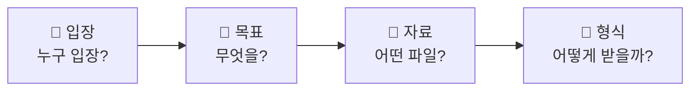

# 04. 일 시키기

## 좋은 지시의 네 가지

| 요소 | 예 |
|---|---|
| **입장** | "나는 구매자 측이야" |
| **목표** | "불리한 조항을 찾고 싶어" |
| **자료** | "`@자료/계약서.docx` 봐줘" |
| **형식** | "표로, `결과물/`에 Word로 저장" |

> 💡 **`@`를 치면 파일 목록이 떠요.** 골라서 넣으면 Claude가 정확히 그 파일을 봐요.

## 나쁜 예 vs 좋은 예
❌ "이 계약서 검토해줘"

✅ "나는 **구매자 측**이야. `@자료/계약서.docx`에서 **구매자에게 불리한 조항**을 찾아서
조항 번호 · 문제점 · 수정 문구 제안을 **표로** 정리하고, `결과물/`에 Word로 저장해줘."

## 팁
- 뭘 말해야 할지 모르겠으면: **"이 작업을 하려면 나한테 뭘 물어봐야 해? 먼저 질문해줘"**
- 큰 작업은 권한 모드를 **Plan**으로 두고 "어떻게 할지 계획만 보여줘" → 괜찮으면 진행

## 예시: 나쁜 지시를 좋은 지시로
| 상황 | ❌ 이렇게 말하면 | ✅ 이렇게 말하기 |
|---|---|---|
| 보고서 요약 | "이거 요약해줘" | "`@자료/보고서.pdf`를 **임원 보고용**으로 요약해줘. 결론 먼저, **세 줄**, 숫자는 그대로." |
| 엑셀 정리 | "엑셀 정리해줘" | "`@자료/거래내역.xlsx`에서 **거래처별 합계**를 내고 큰 순서로 정렬해서 `결과물/`에 **엑셀**로 저장해줘." |
| 이메일 답장 | "답장 써줘" | "나는 **납품업체 담당자**야. 아래 메일에 **배송이 3일 늦어진다**고 사과하는 답장을 **정중하게, 다섯 줄 이내**로 써줘. (메일: …)" |
| 문서 비교 | "뭐 바뀌었어?" | "`@자료/계약서_v1.docx`와 `@자료/계약서_v2.docx`의 **바뀐 조항만** 조항 번호, 이전, 이후 **표**로 보여줘." |

## 예시: 질문 먼저 받기
무엇을 말해야 할지 모를 때는 Claude에게 먼저 물어보게 하세요.

> **🙋 나** 고객 안내문을 쓰려고 해. 쓰기 전에 나한테 필요한 걸 먼저 물어봐줘
>
> **🤖 Claude** 몇 가지만 알려 주세요.
> 1. 무엇을 안내하나요? (일정 변경, 신규 서비스 등)
> 2. 받는 사람은 누구인가요?
> 3. 꼭 들어가야 할 날짜나 금액이 있나요?
> 4. 분량과 형식은요? (A4 한 장, Word 파일 등)
> 💬 예시 대화는 이해를 돕기 위해 만든 것이에요. 실제 Claude의 답은 문장이 조금 다를 수 있어요.
