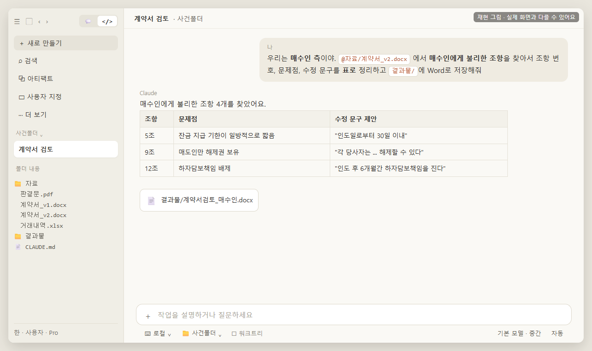

# 04. 일 시키기

## 좋은 지시의 네 가지
신입 어쏘에게 일을 줄 때와 똑같아요.

| 요소 | 예 |
|---|---|
| **입장** | "우리는 매수인 측이야", "피고 대리인 입장에서" |
| **목표** | "불리한 조항을 찾고 싶어", "반박 포인트를 뽑고 싶어" |
| **자료** | "`@자료/계약서_v2.docx` 봐줘" (`@` 치면 목록이 떠요) |
| **형식** | "조항 번호, 문제점, 수정 문구를 표로, Word로 저장" |

## 예시: 계약서 검토

*재현 그림: 입장, 목표, 자료, 형식이 다 들어간 지시와 그 결과*

❌ "이 계약서 검토해줘"

✅ "우리는 **매수인 측**이야. `@자료/계약서_v2.docx`에서 **매수인에게 불리한 조항**을 찾아서
조항 번호 · 문제점 · 수정 문구를 **표로** 정리하고, `결과물/`에 Word로 저장해줘."

## 예시: 이렇게 바꿔 말하기

| 업무 | ❌ 이렇게 말하면 | ✅ 이렇게 말하기 |
|---|---|---|
| 판결문 | "요약해줘" | "`@자료/판결문.pdf`를 **쟁점 · 원고 주장 · 법원 판단**으로 나눠서 **A4 한 장**으로" |
| 거래내역 | "정리해줘" | "`@자료/거래내역.xlsx`에서 **피고 B에게 보낸 돈만** 날짜순으로, 합계 포함, **엑셀**로 저장" |
| 내용증명 | "내용증명 써줘" | "**매도인 측**으로, 매수인 B에게 **잔금 3천만 원을 7일 안에** 지급하라는 내용증명. 정중하지만 단호하게, Word로" |
| 상대 서면 | "반박해줘" | "`@자료/피고준비서면.pdf`의 주장을 번호별로 뽑고, **우리 증거로 반박할 수 있는지** 표로" |

## 예시: 질문 먼저 받기
무엇을 말해야 할지 모를 때는 Claude가 먼저 묻게 하세요.

> **🙋 나** 준비서면 초안을 쓰려고 해. 쓰기 전에 나한테 필요한 걸 먼저 물어봐줘
>
> **🤖 Claude** 몇 가지만 알려 주세요.
> 1. 어느 쪽 대리인인가요? 사건번호와 다음 기일은요?
> 2. 이번 서면에서 반박할 상대방 서면은 어느 파일인가요?
> 3. 꼭 넣을 증거(갑호증 번호)가 있나요?
> 4. 분량과 형식은요? (예: 10쪽 이내, Word)

## 팁
- 큰 작업은 권한 모드를 **계획(Plan)** 모드로 두고 "어떻게 할지 계획만 보여줘" → 괜찮으면 진행

*💬 예시 대화와 재현 그림은 이해를 돕기 위해 만든 것이에요. 사건, 이름, 숫자는 모두 가상이고 실제 답은 조금 다를 수 있어요.*
