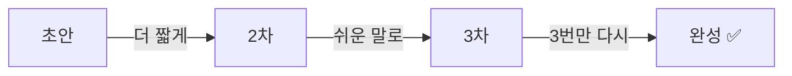

# 05. 이어서 다듬기

결과가 마음에 안 들어도 **처음부터 다시 묻지 마세요.** 같은 작업 안에서 고쳐 달라고 하면 됩니다.

## 자주 쓰는 말 (이게 명령어예요)
| 하고 싶은 것 | 이렇게 말하기 |
|---|---|
| 줄이기 | "A4 한 장으로", "세 줄로 요약" |
| 쉽게 | "처음 보는 사람도 알게 쉬운 말로" |
| 정리 | "표로 정리해줘", "번호 매겨서" |
| 근거 | "근거·출처를 옆에 달아줘" |
| 검토 | "반대 입장에서 반박해봐" |
| 정직하게 | "확실하지 않은 부분은 표시해줘" |
| 부분 수정 | "3번만 다시 써줘, 나머지는 그대로" |
| 되돌리기 | "방금 바꾼 거 원래대로 돌려줘" |
| 저장 | "이대로 `결과물/`에 Word로 저장해줘" |

## 새 작업은 새로
주제가 바뀌면 **Ctrl+N**으로 새 작업을 여세요. 한 작업에 여러 주제가 섞이면 Claude가 헷갈려요.
