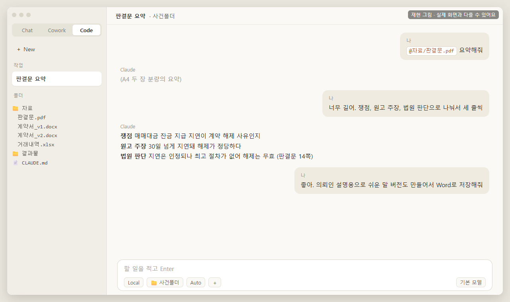

# 05. 이어서 다듬기

결과가 마음에 안 들어도 **처음부터 다시 묻지 마세요.** 같은 작업 안에서 고쳐 달라고 하면 됩니다.

## 예시: 판결문 요약 세 번 만에 완성

*재현 그림: 처음 요약이 길면 짧게 고쳐 달라고 이어서 말하기*

> **🙋 나** `@자료/판결문.pdf` 요약해줘
>
> **🤖 Claude** (A4 두 장 분량의 요약)

> **🙋 나** 너무 길어. 쟁점, 원고 주장, 법원 판단으로 나눠서 세 줄씩
>
> **🤖 Claude** **쟁점** 잔금 지급 지연이 계약 해제 사유인지 / **원고 주장** 30일 넘게 지연돼 해제가 정당하다 / **법원 판단** 지연은 인정되나 최고 절차가 없어 해제는 무효 (판결문 14쪽)

> **🙋 나** 좋아. 의뢰인 설명용으로 쉬운 말 버전도 만들어서 Word로 저장해줘
>
> **🤖 Claude** 법률 용어를 풀어 쓴 설명본을 `결과물/판결문_의뢰인설명.docx`로 저장했어요.

## 자주 쓰는 말 (이게 명령어예요)

| 하고 싶은 것 | 이렇게 말하기 |
|---|---|
| 줄이기 | "A4 한 장으로", "쟁점만 세 줄로" |
| 쉽게 | "의뢰인이 읽을 수 있게 쉬운 말로" |
| 정리 | "표로 정리해줘", "갑호증 번호 순서로" |
| 근거 | "근거가 되는 쪽수와 조항을 옆에 달아줘" |
| 검토 | "상대방 대리인이라면 어떻게 반박할지 써봐" |
| 정직하게 | "확실하지 않은 부분은 표시해줘" |
| 부분 수정 | "3번만 다시 써줘, 나머지는 그대로" |
| 되돌리기 | "방금 바꾼 거 원래대로 돌려줘" |
| 저장 | "이대로 `결과물/`에 Word로 저장해줘" |

## 새 작업은 새로
다른 사건이나 다른 업무로 넘어가면 **Ctrl+N**으로 새 작업을 여세요. 한 작업에 여러 사건이 섞이면 Claude가 헷갈려요.

*💬 예시 대화와 재현 그림은 이해를 돕기 위해 만든 것이에요. 사건, 이름, 숫자는 모두 가상이고 실제 답은 조금 다를 수 있어요.*
