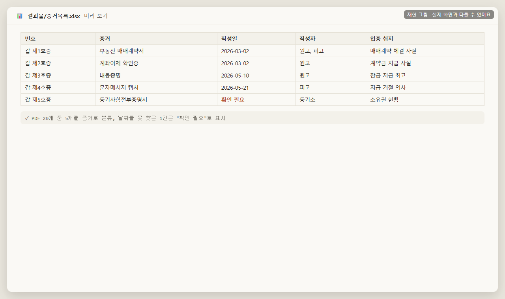

# 06. 파일 작업 예시

그대로 따라 해 보세요. 연습은 **가상의 기록**으로 하세요.

## ① 증거목록 만들기
> **🙋 나** `자료/` 폴더 PDF들로 증거목록을 만들어서 `결과물/증거목록.xlsx`로 저장해줘. 번호, 증거, 작성일, 작성자, 입증 취지 순서로

*재현 그림: 결과물로 생긴 증거목록 엑셀 미리 보기*

→ 날짜를 못 찾은 건 "확인 필요"로 표시돼요. 그 칸은 **직접 확인**하세요.

## ② 계약서 두 버전 비교
> **🙋 나** `@자료/계약서_v1.docx`와 `@자료/계약서_v2.docx`에서 바뀐 조항만 표로, 누구에게 유리한지도

| 조항 | v1 | v2 | 누구에게 유리? |
|---|---|---|---|
| 5조 잔금 지급 | 인도일로부터 30일 | 인도일로부터 **10일** | 매도인에게 유리 |
| 9조 계약 해제 | 각 당사자 | **매도인만** | 매도인에게 유리 |
| 12조 하자담보 | 인도 후 6개월 | **배제** | 매도인에게 유리 |

## ③ 피해금 흐름 정리
> **🙋 나** `@자료/거래내역.xlsx`에서 원고 계좌에서 나간 돈이 어느 계좌로 갔는지, 받은 사람별로 합계를 내서 엑셀로

| 받은 사람 | 건수 | 합계 | 메모 |
|---|---:|---:|---|
| B (1차 계좌) | 9 | 31,500,000 | |
| C | 5 | 12,800,000 | B 계좌에서 당일 재송금 |
| D | 3 | 4,000,000 | ⚠️ 원문 확인 필요 |

## ④ 내용증명 초안
> **🙋 나** 매도인 측으로, 매수인 B에게 잔금 3천만 원을 도달일로부터 7일 안에 지급하라는 내용증명 초안을 Word로. 근거 조항은 `@자료/계약서_v2.docx`에서 찾아서

## ⑤ 상대방 준비서면 정리
> **🙋 나** `@자료/피고준비서면.pdf`의 주장을 번호별로 뽑고, 각 주장에 대해 우리 쪽 반박 근거가 될 갑호증을 옆에 표시해줘

> 표 안의 회사, 이름, 숫자는 모두 예시예요. 결과는 꼭 원본 기록과 대조하세요.
