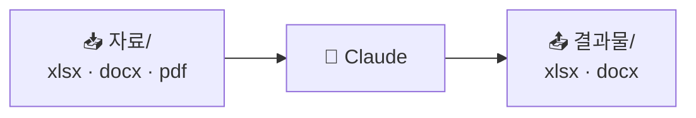

# 06. 파일 작업 예시

그대로 따라 해 보세요. 연습은 **가상의 자료**로 하세요.

## 엑셀 읽기
> "`@자료/거래내역.xlsx`에서 월별 입금·출금 합계를 표로 만들고,
> 이상하게 큰 금액은 따로 표시해줘. 결과는 `결과물/`에 엑셀로 저장해줘."

→ 합계 하나는 **직접 검산**해 보세요.

## Word 만들기
> "아래 내용으로 안내문 초안을 써줘. 정중한 어조로, `결과물/`에 Word로 저장해줘. (내용: …)"

## 긴 문서 요약
> "`@자료/보고서.pdf`를 핵심 쟁점 · 근거 · 결론으로 나눠서 한 장으로 요약해줘."

## 두 파일 비교
> "`@자료/계약서_v1.docx`와 `@자료/계약서_v2.docx`에서 바뀐 부분만 표로 보여줘."

## 여러 파일 한꺼번에
> "`자료/` 폴더의 모든 PDF를 읽고, 파일별로 날짜·당사자·핵심 내용을 한 표로 정리해줘."
