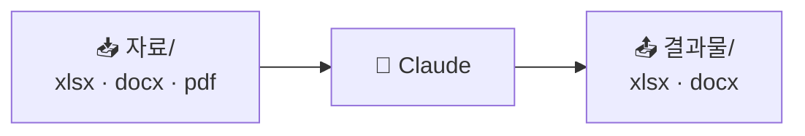

# 06. 파일 작업 예시

그대로 따라 해 보세요. 연습은 **가상의 자료**로 하세요.

## 엑셀 읽기
> "`@자료/거래내역.xlsx`에서 월별 입금·출금 합계를 표로 만들고,
> 이상하게 큰 금액은 따로 표시해줘. 결과는 `결과물/`에 엑셀로 저장해줘."

→ 합계 하나는 **직접 검산**해 보세요.

## Word 만들기
> "아래 내용으로 안내문 초안을 써줘. 정중한 어조로, `결과물/`에 Word로 저장해줘. (내용: …)"

## 긴 문서 요약
> "`@자료/보고서.pdf`를 핵심 쟁점 · 근거 · 결론으로 나눠서 한 장으로 요약해줘."

## 두 파일 비교
> "`@자료/계약서_v1.docx`와 `@자료/계약서_v2.docx`에서 바뀐 부분만 표로 보여줘."

## 여러 파일 한꺼번에
> "`자료/` 폴더의 모든 PDF를 읽고, 파일별로 날짜·당사자·핵심 내용을 한 표로 정리해줘."

## 예시: 결과물은 이렇게 나와요
**월별 합계** (`결과물/월별합계.xlsx`)
| 월 | 입금 | 출금 | 메모 |
|---|---:|---:|---|
| 1월 | 12,400,000 | 9,850,000 | |
| 2월 | 11,900,000 | 10,120,000 | |
| 3월 | 13,050,000 | 31,600,000 | ⚠️ 출금이 평소의 3배 |

**두 계약서 비교**
| 조항 | v1 | v2 | 누구에게 유리? |
|---|---|---|---|
| 5조 대금 지급 | 납품 후 30일 | 납품 후 **60일** | 판매자에게 불리 |
| 9조 계약 해지 | 30일 전 통보 | **7일 전** 통보 | 상대방에게 유리 |
| 12조 위약금 | 계약금의 10% | 변경 없음 | — |

**여러 PDF 한꺼번에**
| 파일 | 날짜 | 당사자 | 핵심 내용 |
|---|---|---|---|
| 회의록_0312.pdf | 2026-03-12 | A사, B사 | 납품 일정 2주 연기 합의 |
| 공문_0405.pdf | 2026-04-05 | B사 | 단가 5% 인상 요청 |
| 회신_0410.pdf | 2026-04-10 | A사 | 인상 거절, 재협상 제안 |

> 표 안의 회사와 숫자는 모두 예시예요. 실제 결과는 꼭 원본과 대조해 보세요.
