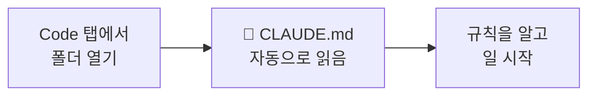
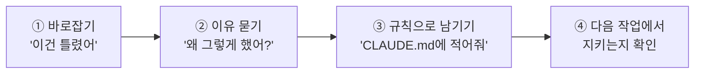

# 07. CLAUDE.md

## 한 줄 정의
**`CLAUDE.md`는 Claude가 작업 폴더를 열 때마다 제일 먼저 읽는 "업무 지시서"예요.**


신입이 출근해서 책상 위 **업무 매뉴얼**을 먼저 읽는 것과 같아요. 매번 같은 설명을 할 필요가 없어져요.

## 무엇을 적나
```markdown
# 작업 폴더 규칙
- 답은 쉬운 한국어로.
- 파일 읽기는 자료/, 저장은 결과물/ 에.
- 자료/ 의 파일은 수정하거나 지우지 않는다.
- 숫자, 출처, 인용은 "원문 확인 필요"라고 표시한다.
- 결과 파일 이름은 "YYYY-MM-DD 내용" 형식으로.
```

## 어떻게 만들고 고치나
직접 편집하지 않아도 돼요. 말로 하면 Claude가 고쳐요.
> "앞으로 결과 파일 이름은 날짜로 시작해줘. CLAUDE.md에도 적어줘."

## Claude가 실수했을 때: 다시 안 하게 만들기
대화에서 "그러지 마"라고만 하면 **그 작업에서만** 기억하고, 다음 작업에서는 잊어요.
같은 실수를 막으려면 **규칙으로 남겨야** 해요.



### 어디에 남길까
| 이런 실수라면 | 남길 곳 | 이렇게 말하기 |
|---|---|---|
| 모든 작업에서 하면 안 되는 것 | `CLAUDE.md` | "CLAUDE.md에 적어줘" |
| 특정 작업에서만 생기는 것 | 그 작업의 **스킬** (08편) | "안내문 스킬에 추가해줘" |
| **절대** 일어나면 안 되는 것 | 설정의 **금지 규칙** | "settings.json에 금지 규칙으로 넣어줘" |

> 💡 CLAUDE.md는 Claude가 **지키려고 노력하는 규칙**이고, 설정의 금지 규칙은 **아예 실행이 막히는 규칙**이에요. 원본 삭제나 수정처럼 정말 중요한 건 둘 다 넣으세요.

### 예시 1: 원본 파일을 고쳐 버렸을 때
> **🙋 나** `자료/계약서.docx`를 왜 고쳤어? 원본은 건드리면 안 돼
>
> **🤖 Claude** 죄송해요. 정리한 내용을 원본에 바로 저장했어요. 원래대로 되돌렸어요.

> **🙋 나** 앞으로 자료 폴더는 절대 수정하지 마. CLAUDE.md에 적고, 설정에도 금지 규칙으로 넣어줘
>
> **🤖 Claude** 두 군데에 넣었어요.
> - CLAUDE.md: "자료/ 파일은 읽기만 한다. 고친 내용은 결과물/에 새 파일로 저장한다."
> - `.claude/settings.json`: `자료/` 폴더 수정 금지 규칙
>
> 이제 제가 실수로 고치려고 해도 실행되지 않아요.

### 예시 2: 계산이 틀렸을 때
> **🙋 나** 3월 합계가 틀렸어. 빈 칸이 있는 행을 빼 버렸잖아
>
> **🤖 Claude** 맞아요. 금액이 빈 행 4개를 계산에서 빼 버렸어요. 빈 칸을 0으로 보고 다시 계산해서 파일을 고쳤어요.

> **🙋 나** 앞으로 계산할 때는 빈 칸을 어떻게 처리했는지, 몇 건을 계산했는지 결과 옆에 꼭 적어줘. CLAUDE.md에도
>
> **🤖 Claude** CLAUDE.md에 "계산 결과에는 계산한 건수와 빈 칸 처리 방법을 함께 적는다"를 추가했어요.

### 예시 3: 스킬대로 했는데 틀렸을 때
> **🙋 나** 안내문에 12월 24일이 화요일로 나왔어. 수요일이야
>
> **🤖 Claude** 죄송해요, 요일을 잘못 적었어요. 수요일로 고쳤어요.

> **🙋 나** 안내문 스킬에 "요일은 달력으로 계산해서 확인한다"를 추가해줘
>
> **🤖 Claude** 안내문 스킬 2번에 추가했어요. 다음 안내문부터는 요일을 계산해서 확인할게요.

*💬 예시 대화는 이해를 돕기 위해 만든 것이에요. 실제 Claude의 답은 문장이 조금 다를 수 있어요.*

## 어디에 두나

| 위치 | 적용 범위 |
|---|---|
| 작업 폴더의 `CLAUDE.md` | 그 폴더에서만 |
| `C:\Users\<사용자>\.claude\CLAUDE.md` | 내 모든 작업에 |

## 예시: CLAUDE.md가 있을 때와 없을 때
같은 말을 했을 때 이렇게 달라져요.

> **🙋 나** `@자료/보고서.pdf` 요약해서 저장해줘

| | CLAUDE.md 없음 | CLAUDE.md 있음 |
|---|---|---|
| 말투 | 영어 용어가 섞인 긴 답 | 쉬운 한국어 |
| 저장 위치 | 폴더 맨 위에 `summary.md` | `결과물/2026-11-20 보고서 요약.docx` |
| 숫자 | 그냥 씀 | "원문 확인 필요" 표시 |

## 예시: 말로 규칙 추가하기
> **🙋 나** 앞으로 결과 파일은 Word로 저장하고, 이름은 날짜로 시작해줘. CLAUDE.md에도 적어줘
>
> **🤖 Claude** CLAUDE.md에 두 줄을 추가했어요.
> - 결과 파일은 Word(.docx)로 저장한다.
> - 결과 파일 이름은 "YYYY-MM-DD 내용" 형식으로 한다.
>
> 다음 작업부터 이 규칙을 따를게요.

*💬 예시 대화는 이해를 돕기 위해 만든 것이에요. 실제 Claude의 답은 문장이 조금 다를 수 있어요.*

📖 공식: [CLAUDE.md와 메모리](https://code.claude.com/docs/en/memory)
