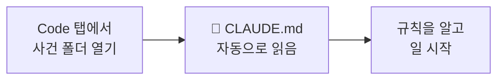
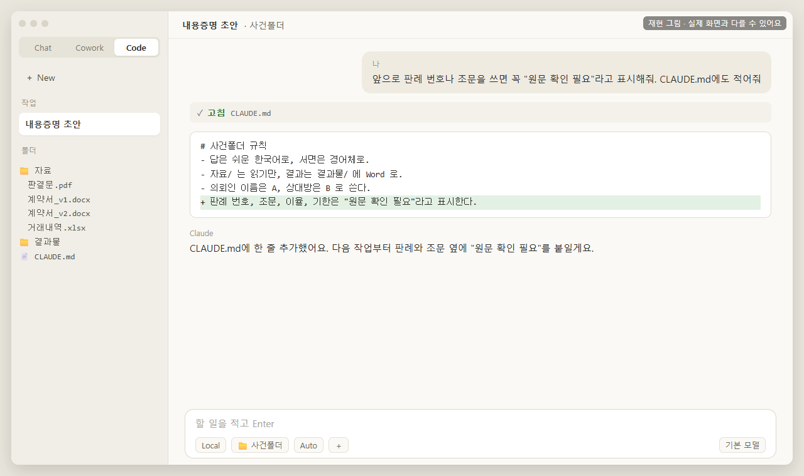
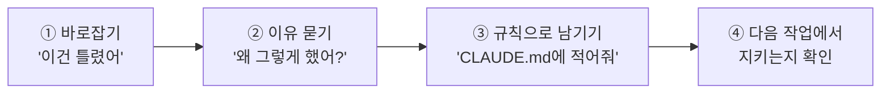
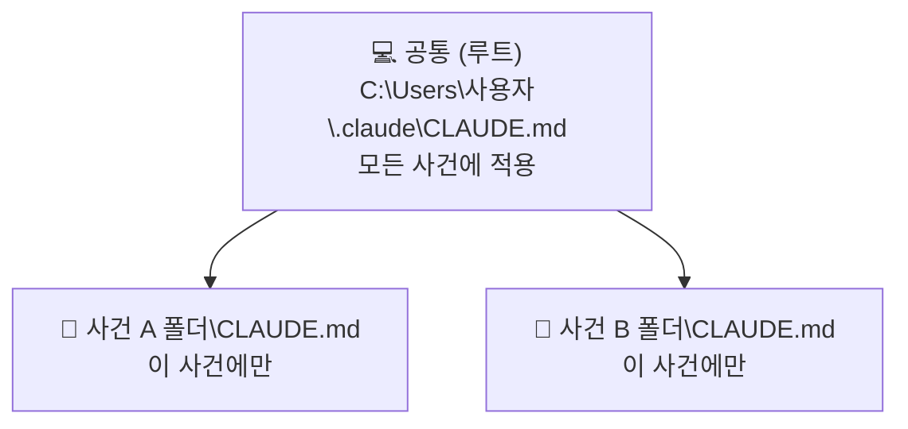
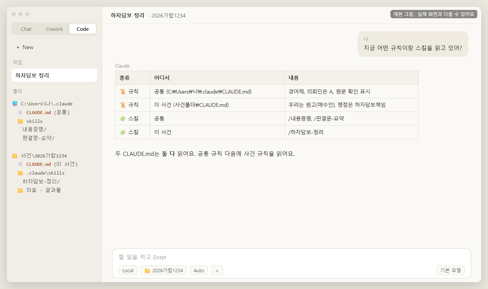

# 07. CLAUDE.md

## 한 줄 정의
**`CLAUDE.md`는 Claude가 사건 폴더를 열 때마다 제일 먼저 읽는 "업무 지시서"예요.**


신입 어쏘가 출근해서 **사건 메모와 사무실 규칙**을 먼저 읽는 것과 같아요. 매번 같은 설명을 할 필요가 없어져요.

## 무엇을 적나
```markdown
# 2026가합1234 매매대금 사건
- 우리는 원고(매도인) 대리인이다.
- 답은 쉬운 한국어로, 서면은 경어체로.
- 자료/ 는 읽기만, 결과는 결과물/ 에 Word 로.
- 의뢰인은 A, 상대방은 B 로 쓴다.
- 판례 번호, 조문, 이율, 기한은 "원문 확인 필요"라고 표시한다.
- 결과 파일 이름은 "YYYY-MM-DD 내용" 형식으로.
```

## 예시: CLAUDE.md가 있을 때와 없을 때
> **🙋 나** `@자료/판결문.pdf` 요약해서 저장해줘

| | CLAUDE.md 없음 | CLAUDE.md 있음 |
|---|---|---|
| 입장 | 중립적인 요약 | **원고 측에서 볼 쟁점** 중심 |
| 저장 위치 | 폴더 맨 위 `summary.md` | `결과물/2026-11-20 판결문 요약.docx` |
| 판례·조문 | 그냥 씀 | "원문 확인 필요" 표시 |

## 예시: 말로 규칙 추가하기

*재현 그림: 말로 시키면 Claude가 CLAUDE.md에 규칙을 추가해요*

> **🙋 나** 앞으로 판례 번호나 조문을 쓰면 꼭 "원문 확인 필요"라고 표시해줘. CLAUDE.md에도 적어줘
>
> **🤖 Claude** CLAUDE.md에 한 줄 추가했어요. 다음 작업부터 판례와 조문 옆에 "원문 확인 필요"를 붙일게요.

## Claude가 실수했을 때: 다시 안 하게 만들기
대화에서 "그러지 마"라고만 하면 **그 작업에서만** 기억하고, 다음 작업에서는 잊어요.
같은 실수를 막으려면 **규칙으로 남겨야** 해요.



### 어디에 남길까

| 이런 실수라면 | 남길 곳 | 이렇게 말하기 |
|---|---|---|
| 모든 작업에서 하면 안 되는 것 | `CLAUDE.md` | "CLAUDE.md에 적어줘" |
| 특정 업무에서만 생기는 것 | 그 업무의 **스킬** (08편) | "내용증명 스킬에 추가해줘" |
| **절대** 일어나면 안 되는 것 | 설정의 **금지 규칙** | "settings.json에 금지 규칙으로 넣어줘" |

> 💡 CLAUDE.md는 Claude가 **지키려고 노력하는 규칙**이고, 설정의 금지 규칙은 **아예 실행이 막히는 규칙**이에요. 원본 기록 수정처럼 정말 중요한 건 둘 다 넣으세요.

### 예시 1: 원본 기록을 고쳐 버렸을 때
> **🙋 나** `자료/계약서_v2.docx`를 왜 고쳤어? 기록 원본은 건드리면 안 돼
>
> **🤖 Claude** 죄송해요. 검토 의견을 원본에 바로 저장했어요. 원래대로 되돌렸어요.

> **🙋 나** 앞으로 자료 폴더는 절대 수정하지 마. CLAUDE.md에 적고, 설정에도 금지 규칙으로 넣어줘
>
> **🤖 Claude** 두 군데에 넣었어요. CLAUDE.md에 "자료/는 읽기만, 고친 내용은 결과물/에 새 파일로", `.claude/settings.json`에 `자료/` 수정 금지. 이제 실수로 고치려 해도 실행되지 않아요.

### 예시 2: 지연손해금 계산 기간이 틀렸을 때
> **🙋 나** 지연손해금 기산일이 틀렸어. 지급기일 다음 날부터야
>
> **🤖 Claude** 맞아요. 지급기일 당일부터 계산했어요. 다음 날부터 다시 계산해서 표를 고쳤어요.

> **🙋 나** 앞으로 기간 계산하면 기산일과 종료일, 일수를 표 옆에 꼭 적어줘. CLAUDE.md에도
>
> **🤖 Claude** CLAUDE.md에 "기간 계산에는 기산일, 종료일, 일수를 함께 적는다"를 추가했어요.

### 예시 3: 스킬대로 했는데 틀렸을 때
> **🙋 나** 내용증명에 기한을 "7일 이내"라고만 썼네. 언제부터 7일인지가 빠졌어
>
> **🤖 Claude** "도달일로부터 7일 이내"로 고쳤어요.

> **🙋 나** 내용증명 스킬에 "기한은 언제부터인지 반드시 쓴다"를 추가해줘
>
> **🤖 Claude** 내용증명 스킬 3번에 추가했어요.

## 어디에 두나: 공통(루트)과 사건별(프로젝트)
CLAUDE.md는 **두 군데**에 둘 수 있고, **둘 다 읽혀요.**



| 위치 | 적용 범위 | 무엇을 적나 | 예 |
|---|---|---|---|
| **공통** `C:\Users\<사용자>\.claude\CLAUDE.md` | 내 PC의 **모든 사건** | 사무실 공통 원칙 | 경어체, 의뢰인은 A로, 원문 확인 표시, 결과 파일 이름 규칙 |
| **사건별** `사건폴더\CLAUDE.md` | **그 사건**에서만 | 이 사건의 사실과 입장 | 우리는 원고(매수인), 다음 기일 12/10, 쟁점은 하자담보 |
| (개인) `사건폴더\CLAUDE.local.md` | 그 사건, **나만** | GitHub에 안 올릴 개인 메모 | "이 사건은 표를 크게" |

### 어떻게 합쳐지나
- 공통과 사건별 CLAUDE.md는 **덮어쓰지 않고 둘 다 읽어요.** 공통을 먼저, 사건별을 나중에 읽어요.
- 사건 폴더의 **하위 폴더**에 CLAUDE.md가 있으면, Claude가 그 폴더의 파일을 볼 때 추가로 읽어요.
- 두 곳의 규칙이 **서로 반대**면 Claude가 아무거나 따를 수 있어요. 공통에는 원칙만, 사건별에는 그 사건만의 내용만 적으세요.

### 예시: 공통에 둘까, 사건에 둘까

| 규칙 | 어디에 |
|---|---|
| "서면은 경어체로" | 공통 |
| "판례·조문은 원문 확인 필요 표시" | 공통 |
| "우리는 매수인 측 대리인" | 사건별 |
| "피고 준비서면 3차까지 제출됨" | 사건별 |

> **🙋 나** 앞으로 모든 사건에서 결과 파일 이름은 날짜로 시작해줘. **공통 CLAUDE.md**에 적어줘
>
> **🤖 Claude** `C:\Users\나\.claude\CLAUDE.md`에 추가했어요. 이제 어느 사건 폴더에서든 적용돼요.

> **🙋 나** 이 사건은 우리가 매수인 측이야. **이 사건 CLAUDE.md**에 적어줘
>
> **🤖 Claude** 사건 폴더의 CLAUDE.md에 추가했어요. 다른 사건에는 적용되지 않아요.

### 예시: 지금 무엇을 읽고 있는지 확인하기

*재현 그림: 공통과 사건별 규칙, 스킬을 함께 읽는 모습*

> **🙋 나** 지금 어떤 규칙이랑 스킬을 읽고 있어?

이렇게 물으면 공통과 사건별로 무엇이 적용되는지 알려 줘요. 입력창에 `/memory`를 쳐도 CLAUDE.md 위치 목록이 나와요.

*💬 예시 대화와 재현 그림은 이해를 돕기 위해 만든 것이에요. 사건, 이름, 숫자는 모두 가상이고 실제 답은 조금 다를 수 있어요.*

📖 공식: [CLAUDE.md와 메모리](https://code.claude.com/docs/en/memory)
