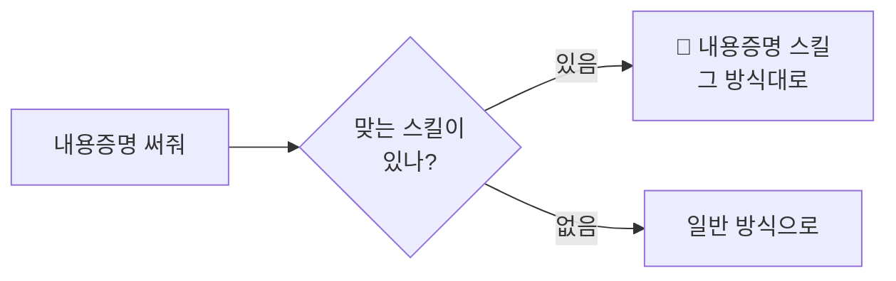
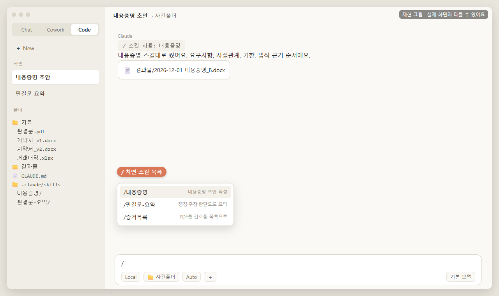
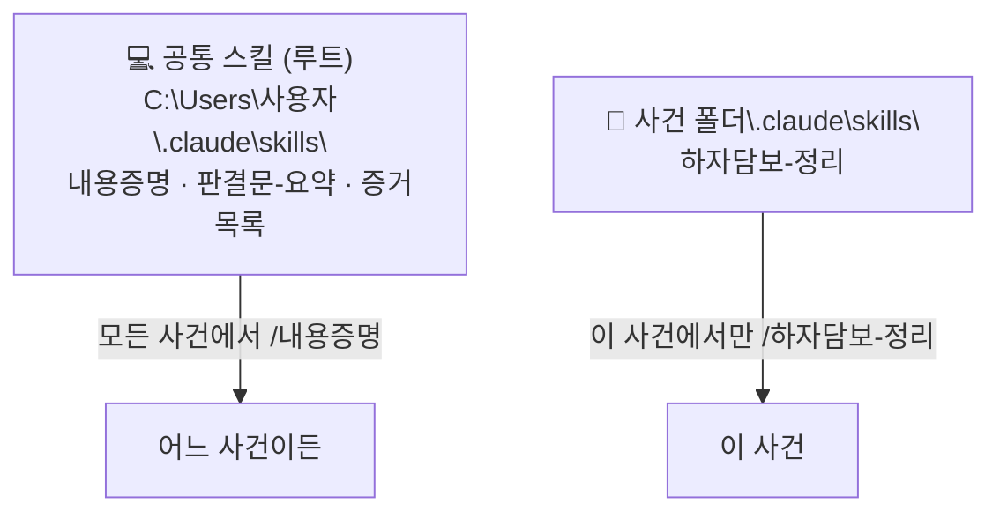
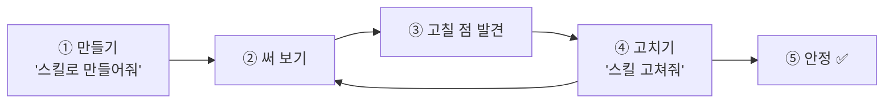

# 08. 스킬

## 한 줄 정의
**특정 업무를 잘하는 방법을 적어 둔 "업무 매뉴얼 한 장"**이에요.
`CLAUDE.md`가 늘 읽는 사건 메모라면, 스킬은 **그 업무를 할 때만 꺼내 보는 매뉴얼**이에요.



## 스킬 목록 보기

*재현 그림: / 를 치면 스킬 목록이 뜨고, 고르면 그 방식대로 써요*

## 어디에 두나: 공통(루트) 스킬과 사건별(프로젝트) 스킬


| 위치 | 적용 범위 | 이런 스킬 |
|---|---|---|
| **공통** `C:\Users\<사용자>\.claude\skills\이름\SKILL.md` | 내 PC의 **모든 사건** | 내용증명, 판결문 요약, 증거목록처럼 **어느 사건에서나** 하는 업무 |
| **사건별** `사건폴더\.claude\skills\이름\SKILL.md` | **그 사건**에서만 | 이 사건 쟁점 정리, 이 사건 서면 양식처럼 **이 사건에만** 맞는 방법 |

- **이름이 같으면 공통 스킬이 이겨요.** 공통에 `내용증명`이 있으면 사건 폴더의 `내용증명`은 쓰이지 않아요. 사건용은 `내용증명-임대차`처럼 이름을 다르게 지으세요.
- 사건 폴더 안의 **하위 폴더**에 둔 스킬은, Claude가 그 하위 폴더 파일을 볼 때부터 쓸 수 있어요.

### 예시: 공통으로 만들까, 사건용으로 만들까
> **🙋 나** 방금 한 내용증명 방식, 다른 사건에서도 쓰게 **공통 스킬**로 만들어줘
>
> **🤖 Claude** `C:\Users\나\.claude\skills\내용증명\SKILL.md`로 만들었어요. 이제 어느 사건 폴더에서든 `/내용증명`을 쓸 수 있어요.

> **🙋 나** 하자 목록을 사진 번호랑 묶어서 정리한 방식은 **이 사건에서만** 쓸 스킬로 만들어줘
>
> **🤖 Claude** 사건 폴더의 `.claude\skills\하자담보-정리\SKILL.md`로 만들었어요. 다른 사건에는 나타나지 않아요.

## SKILL.md 생김새
```markdown
---
name: 내용증명
description: 내용증명 초안을 쓸 때 사용. 요구사항, 사실관계, 기한, 법적 근거 순서로 작성.
---

1. 첫 문단에 요구사항을 한 문장으로 쓴다.
2. 사실관계는 날짜순으로 짧게 정리한다.
3. 기한은 "도달일로부터 7일 이내"처럼 언제부터인지 반드시 쓴다.
4. 법적 근거는 조문만 쓰고 "원문 확인 필요"라고 표시한다.
5. 정중하지만 단호한 어조로, 결과물/YYYY-MM-DD 내용증명_상대방.docx 로 저장한다.
```
**description**이 제일 중요해요. Claude는 이걸 보고 "지금 이 스킬을 꺼낼까?"를 판단해요.

## 스킬로 만들 만한 업무

| 스킬 | 하는 일 |
|---|---|
| 내용증명 | 요구사항, 사실관계, 기한, 근거 순서로 초안 |
| 판결문-요약 | 쟁점 · 원고 주장 · 피고 주장 · 법원 판단으로 한 장 |
| 증거목록 | 기록 PDF를 갑호증 번호, 작성일, 입증 취지 표로 |
| 송금내역 | 거래내역에서 받은 사람별 합계와 흐름 |

## 예시: 대화에서 스킬 만들고 다시 쓰기
**① 한 번 잘 된 작업**
> **🙋 나** 매수인 B에게 잔금 지급을 요구하는 내용증명 써줘. 요구사항 먼저, 기한은 도달일로부터 7일, 근거 조항 표시, Word로
>
> **🤖 Claude** `결과물/2026-11-20 내용증명_B.docx`로 저장했어요.

**② 스킬로 남기기**
> **🙋 나** 방금 한 방식을 "내용증명" 스킬로 만들어줘
>
> **🤖 Claude** `.claude/skills/내용증명/SKILL.md`를 만들었어요.

**③ 다음에는 짧게만 말해도**
> **🙋 나** 임차인 C에게 밀린 차임 900만 원 지급 요구하는 내용증명
>
> **🤖 Claude** 내용증명 스킬대로 썼어요. 요구사항, 사실관계, 기한(도달일로부터 7일), 근거 순서로 `결과물/2026-12-01 내용증명_C.docx`에 저장했어요.

**④ 고치기**
> **🙋 나** 내용증명 스킬에 "회신이 없으면 법적 조치를 하겠다는 문단은 선택으로 넣는다"를 추가해줘

## 스킬의 일생


## 쓰는 말

| 하고 싶은 것 | 이렇게 말하기 |
|---|---|
| 만들기 | "방금 한 방식을 스킬로 만들어줘" |
| 목록 보기 | `/` 치면 스킬 목록이 떠요 |
| 꼭 쓰게 하기 | "내용증명 스킬로 써줘" 또는 `/내용증명` |
| 고치기 | "내용증명 스킬에 ○○를 추가해줘" |
| 없애기 | "이 스킬은 이제 안 써. 지워줘" |

> 스킬에는 **방식**만 담고, 특정 의뢰인이나 사건 내용은 넣지 마세요.

*💬 예시 대화와 재현 그림은 이해를 돕기 위해 만든 것이에요. 사건, 이름, 숫자는 모두 가상이고 실제 답은 조금 다를 수 있어요.*

📖 공식: [스킬](https://code.claude.com/docs/en/skills)
