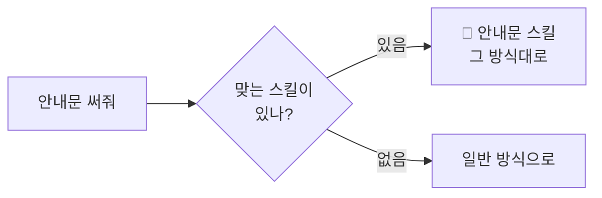
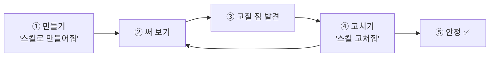

# 08. 스킬

## 한 줄 정의
**특정 작업을 잘하는 방법을 적어 둔 "작업 매뉴얼 한 장"**이에요.
`CLAUDE.md`가 늘 읽는 업무 지시서라면, 스킬은 **그 작업을 할 때만 꺼내 보는 매뉴얼**이에요.



## 어디에 있나
```
작업폴더/.claude/skills/      ← 이 폴더에서만 쓰는 스킬
└── 안내문/
    └── SKILL.md

C:\Users\<사용자>\.claude\skills\   ← 내 모든 작업에서 쓰는 스킬
```

## SKILL.md 생김새
```markdown
---
name: 안내문
description: 고객 안내문 초안을 쓸 때 사용. 요점, 일정, 문의처 순서로 작성.
---

1. 첫 문단에 요점을 한 문장으로 쓴다.
2. 일정은 날짜와 요일을 같이 쓴다.
3. 마지막에 문의처를 쓴다.
4. 결과는 결과물/YYYY-MM-DD 안내문.docx 로 저장한다.
```
**description**이 제일 중요해요. Claude는 이걸 보고 "지금 이 스킬을 꺼낼까?"를 판단해요.

## 스킬의 일생


## 쓰는 말
| 하고 싶은 것 | 이렇게 말하기 |
|---|---|
| 만들기 | "방금 한 방식을 스킬로 만들어줘" |
| 목록 보기 | `/` 치면 스킬 목록이 떠요 |
| 꼭 쓰게 하기 | "안내문 스킬로 써줘" 또는 `/안내문` |
| 고치기 | "안내문 스킬에 '문의처는 굵게'를 추가해줘" |
| 없애기 | "이 스킬은 이제 안 써. 지워줘" |

> 스킬에는 **방식**만 담고, 특정 사람·사건의 정보는 넣지 마세요.

📖 공식: [스킬](https://code.claude.com/docs/en/skills)
