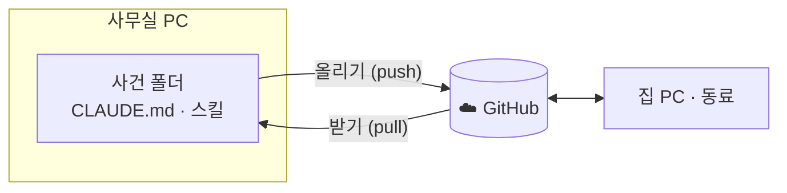
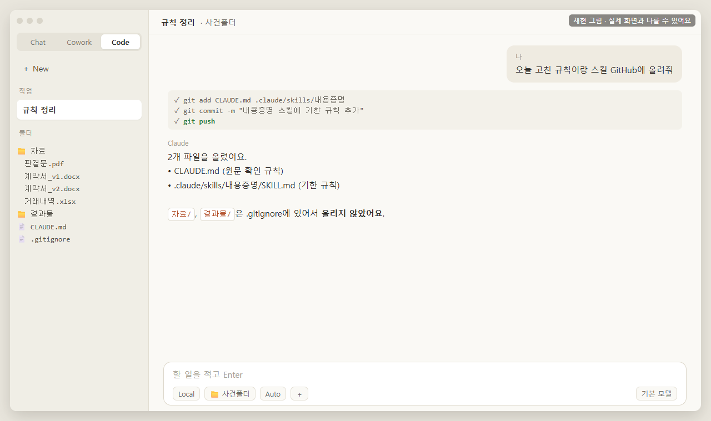

# 09. GitHub 기초

## GitHub란?
**폴더를 온라인에 보관하고 다른 PC나 다른 사람과 주고받는 곳**이에요. 바뀐 기록이 전부 남아서 언제든 되돌릴 수 있어요.
사무실 PC와 집 PC에서 **같은 규칙과 스킬**을 쓰고 싶을 때 유용해요. 명령어 없이 **Claude에게 말로 시키면 돼요.**



## 알아야 할 단어 세 개뿐

| 단어 | 뜻 | 이렇게 말하기 |
|---|---|---|
| **저장소** | GitHub에 있는 폴더 (반드시 **비공개**) | — |
| **push (올리기)** | 내 PC → GitHub | "GitHub에 올려줘" |
| **pull (받기)** | GitHub → 내 PC | "GitHub에서 최신 내용 받아줘" |

## 올리면 안 되는 것
**기록과 결과물은 절대 올리지 않아요.** 폴더에 `.gitignore` 파일로 제외할 폴더를 적어 두면 Claude가 실수로 올리지 않아요.
```
자료/
결과물/
```
올리는 건 `CLAUDE.md`와 스킬처럼 **일하는 방식**뿐이에요.

## 예시: 말로 올리고 받기

*재현 그림: 말로 시키면 규칙과 스킬만 올리고, 자료와 결과물은 빼요*

> **🙋 나** 오늘 고친 규칙이랑 스킬 GitHub에 올려줘
>
> **🤖 Claude** 2개 파일을 올렸어요. CLAUDE.md (원문 확인 규칙), 내용증명 스킬 (기한 규칙). `자료/`, `결과물/`은 .gitignore에 있어서 올리지 않았어요.

> **🙋 나** 집 PC에서 고친 거 받아줘
>
> **🤖 Claude** 최신 내용을 받았어요. 판결문-요약 스킬에 "피고 주장 칸 추가"가 들어왔어요.

## 이런 메시지가 보이면

| Claude가 말하면 | 뜻 | 할 일 |
|---|---|---|
| "올리기 실패" | 인터넷이나 로그인 문제 | 작업은 PC에 그대로 있어요. 나중에 다시 |
| "충돌이 있어요" | 같은 파일을 다른 PC에서도 고침 | "어떻게 하면 돼?"라고 물어보기 |
| "로그인이 필요해요" | GitHub 연결이 끊김 | 도와줄 사람에게 연락 |

*💬 예시 대화와 재현 그림은 이해를 돕기 위해 만든 것이에요. 사건, 이름, 숫자는 모두 가상이고 실제 답은 조금 다를 수 있어요.*
