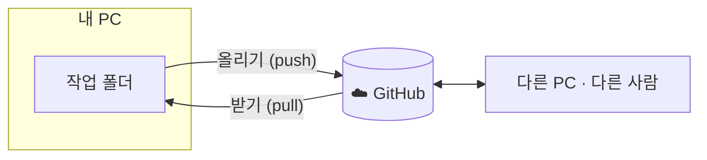

# 09. GitHub 기초

## GitHub란?
**폴더를 온라인에 보관하고 다른 사람과 주고받는 곳**이에요. 바뀐 기록이 전부 남아서 언제든 되돌릴 수 있어요.
직접 명령어를 칠 필요 없이 **Claude에게 말로 시키면 돼요.**



## 알아야 할 단어 세 개뿐

| 단어 | 뜻 | 이렇게 말하기 |
|---|---|---|
| **저장소** | GitHub에 있는 폴더 | — |
| **push (올리기)** | 내 PC → GitHub | "GitHub에 올려줘" |
| **pull (받기)** | GitHub → 내 PC | "GitHub에서 최신 내용 받아줘" |

## 올리면 안 되는 것
개인정보나 원본 자료는 올리지 않아요. 폴더에 `.gitignore` 파일로 **제외할 폴더**를 적어 두면 Claude가 실수로 올리지 않아요.
```
자료/
결과물/
```

## 예시: 말로 올리고 받기
> **🙋 나** 오늘 고친 거 GitHub에 올려줘
>
> **🤖 Claude** 바뀐 파일 3개를 올렸어요.
> - CLAUDE.md (규칙 2줄 추가)
> - .claude/skills/안내문/SKILL.md (새 스킬)
> - 노하우.md
>
> `자료/`, `결과물/`은 `.gitignore`에 있어서 올리지 않았어요.

> **🙋 나** 다른 PC에서 고친 거 받아줘
>
> **🤖 Claude** 최신 내용을 받았어요. CLAUDE.md에 "숫자는 천 단위 콤마" 규칙이 새로 들어왔어요.

*💬 예시 대화는 이해를 돕기 위해 만든 것이에요. 실제 Claude의 답은 문장이 조금 다를 수 있어요.*

## 이런 메시지가 보이면

| Claude가 말하면 | 뜻 | 할 일 |
|---|---|---|
| "올리기 실패" | 인터넷이나 로그인 문제 | 작업은 PC에 그대로 있어요. 나중에 다시 |
| "충돌이 있어요" | 같은 파일을 다른 곳에서도 고침 | "어떻게 하면 돼?"라고 물어보기 |
