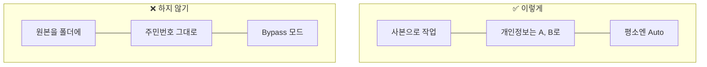

# 10. 안전하게 쓰기

1. **인용·숫자는 원문으로 확인**
   출처, 조문, 계산 결과를 그럴듯하게 틀릴 수 있어요. 원문 확인 전에는 쓰지 마세요.
2. **사본으로 작업**
   Claude는 폴더 안 파일을 고칠 수 있어요. 원본은 넣지 마세요.
3. **민감한 정보는 지우기**
   실명, 주민번호, 연락처는 A·B로 바꾸거나 지우세요.
4. **평소엔 Auto, Bypass는 쓰지 않기**
   모르는 허락 요청은 거절하고 물어보세요.
5. **큰 작업은 Plan 먼저**
   계획을 보고 괜찮을 때 진행하세요.
6. **최종 판단은 사람이**
   Claude는 초안까지. 책임은 사람에게 있어요.

## 예시: 개인정보 바꾸기
| ❌ 그대로 넣으면 | ✅ 이렇게 바꿔서 |
|---|---|
| 홍길동(900101-1234567)은 | **A**는 |
| 010-1234-5678로 연락 | 연락처 **(삭제)** |
| 주식회사 한빛상사와 | **甲사**와 |

Claude에게 시켜도 돼요.
> **🙋 나** `@자료/진술서.docx`에서 이름은 A, B로, 주민번호와 연락처는 지워서 `자료/진술서_비식별.docx`로 저장해줘. 원본은 건드리지 마

## 예시: "원문 확인 필요" 표시
CLAUDE.md에 규칙을 넣어 두면 이렇게 나와요.
> 대금 지급 기한은 납품 후 60일입니다 **(원문 확인 필요: 계약서 5조)**.
> 지연 이자는 연 6%가 적용될 수 있습니다 **(원문 확인 필요: 근거 조문)**.

표시된 곳은 반드시 원문과 대조한 뒤에 쓰세요.
> 💬 예시 대화는 이해를 돕기 위해 만든 것이에요. 실제 Claude의 답은 문장이 조금 다를 수 있어요.
