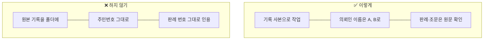
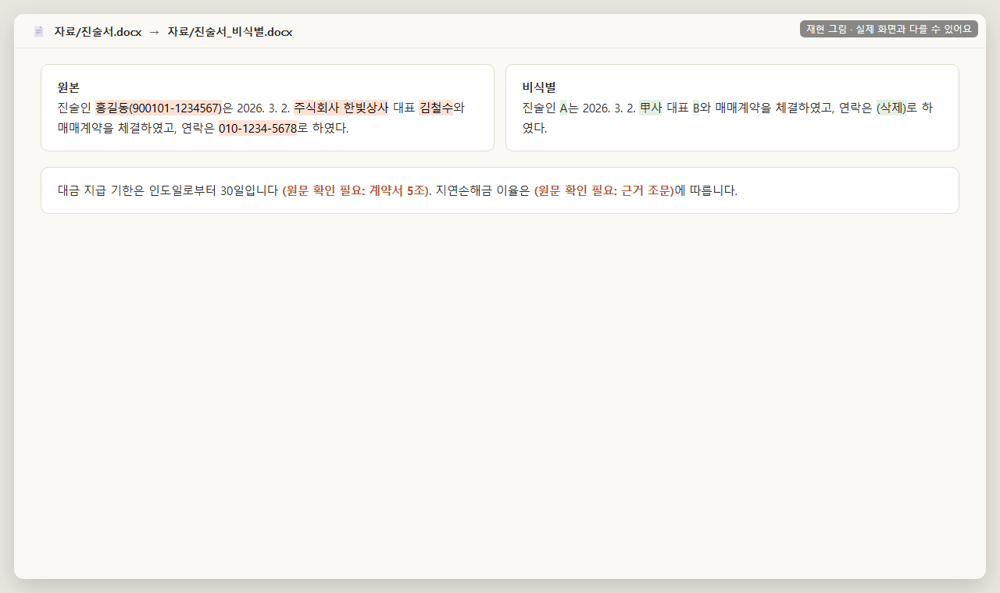

# 10. 안전하게 쓰기

1. **판례·조문·이율은 원문으로 확인**
   그럴듯하게 틀릴 수 있어요. **없는 판례를 만들어 낼 수도 있어요.** 법원 종합법률정보, 국가법령정보센터에서 확인하기 전에는 서면에 쓰지 마세요.
2. **기록은 사본으로**
   Claude는 폴더 안 파일을 고칠 수 있어요. 원본 기록은 넣지 마세요.
3. **개인정보는 지우거나 바꾸기**
   실명, 주민번호, 연락처, 계좌번호는 A·B로 바꾸거나 지우세요.
4. **평소엔 Auto, Bypass는 쓰지 않기**
   모르는 허락 요청은 거절하고 물어보세요.
5. **큰 작업은 Plan 먼저**
   계획을 보고 괜찮을 때 진행하세요.
6. **최종 판단은 변호사가**
   Claude는 초안까지. 책임은 사람에게 있어요.

## 예시: 개인정보 바꾸기

*재현 그림: 원본과 비식별 사본, 원문 확인 표시*

> **🙋 나** `@자료/진술서.docx`에서 사람 이름은 A, B로, 회사는 甲사로, 주민번호와 연락처는 지워서 `자료/진술서_비식별.docx`로 저장해줘. 원본은 건드리지 마

| ❌ 그대로 넣으면 | ✅ 이렇게 바꿔서 |
|---|---|
| 홍길동(900101-1234567)은 | **A**는 |
| 010-1234-5678로 연락 | 연락처 **(삭제)** |
| 주식회사 한빛상사 대표 김철수와 | **甲사** 대표 **B**와 |

## 예시: "원문 확인 필요" 표시
CLAUDE.md에 규칙을 넣어 두면 이렇게 나와요.
> 잔금 지급 기한은 인도일로부터 30일입니다 **(원문 확인 필요: 계약서 5조)**.
> 해제에는 상당한 기간을 정한 최고가 필요하다는 판례가 있습니다 **(원문 확인 필요: 판례 번호)**.

표시된 곳은 반드시 원문과 대조한 뒤에 쓰세요.

## 예시: 판례를 물어볼 때
> **🙋 나** 잔금 지급 지연으로 해제할 때 최고가 필요한지 판례 찾아줘. 확실하지 않으면 확실하지 않다고 하고, 웹 검색으로 찾은 건 출처 링크를 달아줘

"확실하지 않으면 확실하지 않다고 해줘"를 붙이면 지어낸 답이 줄어요. 그래도 **번호와 내용은 반드시 직접 확인**하세요.

*💬 예시 대화와 재현 그림은 이해를 돕기 위해 만든 것이에요. 사건, 이름, 숫자는 모두 가상이고 실제 답은 조금 다를 수 있어요.*
