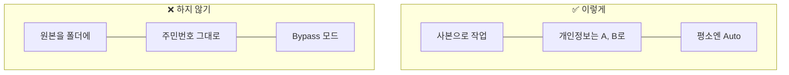

# 10. 안전하게 쓰기

1. **인용·숫자는 원문으로 확인**
   출처, 조문, 계산 결과를 그럴듯하게 틀릴 수 있어요. 원문 확인 전에는 쓰지 마세요.
2. **사본으로 작업**
   Claude는 폴더 안 파일을 고칠 수 있어요. 원본은 넣지 마세요.
3. **민감한 정보는 지우기**
   실명, 주민번호, 연락처는 A·B로 바꾸거나 지우세요.
4. **평소엔 Auto, Bypass는 쓰지 않기**
   모르는 허락 요청은 거절하고 물어보세요.
5. **큰 작업은 Plan 먼저**
   계획을 보고 괜찮을 때 진행하세요.
6. **최종 판단은 사람이**
   Claude는 초안까지. 책임은 사람에게 있어요.
