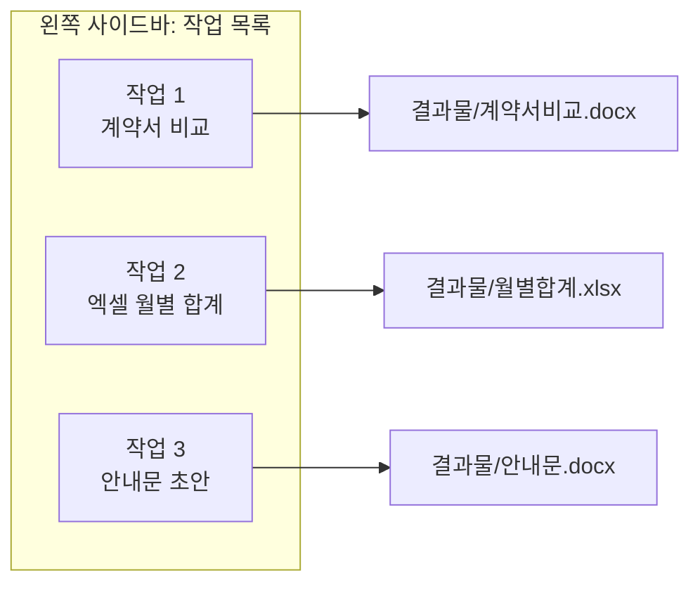
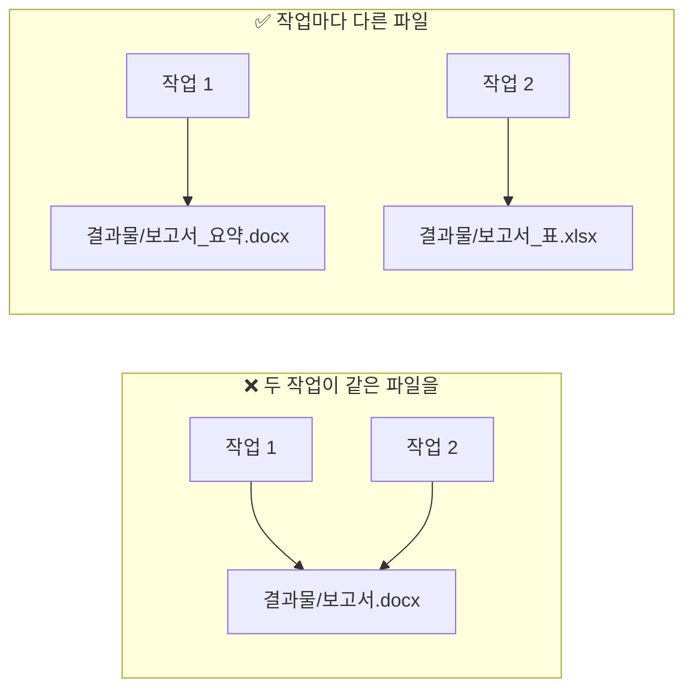

# 11. 여러 작업 동시에

Code 탭에서는 **작업(세션)을 여러 개 열어 동시에** 돌릴 수 있어요. Windows 앱도 똑같아요.
Claude가 계약서를 비교하는 동안 다른 작업에서 엑셀 합계를 내고, 또 다른 작업에서 안내문을 쓰게 할 수 있어요.

## 여는 법, 오가는 법

| 하고 싶은 것 | 방법 |
|---|---|
| 새 작업 열기 | 사이드바 **+ New** 또는 **Ctrl+N** |
| 작업 사이 이동 | 사이드바에서 클릭, 또는 **Ctrl+Tab** / **Ctrl+Shift+Tab** |
| 두 작업 나란히 보기 | **Alt**를 누른 채 사이드바의 작업 클릭 (또는 오른쪽 클릭 › Open in › Split view) |
| 작업을 새 창으로 | **Ctrl**을 누른 채 클릭 (또는 오른쪽 클릭 › Open in › New window) |
| 나란히 보기 끝내기 | **Ctrl+Alt+W** |
| 한 작업만 멈추기 | 그 작업에서 **Esc** |

## 끝나면 알려 줘요
다른 작업을 보고 있을 때 어떤 작업이 끝나면 **Windows 알림**이 떠요. 알림을 보고 그 작업으로 가서 결과를 확인하면 돼요.

> ⚠️ 작업은 **앱이 켜져 있는 동안만** 돌아가요. 앱을 닫으면 멈춰요.

## 꼭 지킬 것: 같은 파일은 한 작업만

동시에 도는 작업들은 **같은 폴더의 같은 파일**을 보고 있어요. 두 작업이 같은 파일을 고치면 서로 덮어써요.
- 작업마다 **결과 파일 이름을 다르게** 정해 주세요. "결과는 `결과물/보고서_요약.docx`로"
- 같은 문서를 여러 번 고치는 일은 **한 작업 안에서** 이어서 하세요.
- (심화) 개발자용 **Worktree** 기능을 켜면 작업마다 폴더 사본에서 일해서 서로 안 부딪혀요. 다만 결과 파일도 사본 폴더에 생겨서 문서 작업에는 헷갈릴 수 있어요. 처음에는 위의 "파일 이름 다르게"로 충분해요.

## 예시: 세 가지 일을 한꺼번에 맡기기
**작업 1** (Ctrl+N)
> **🙋 나** `@자료/계약서_v1.docx`와 `@자료/계약서_v2.docx`의 바뀐 조항만 표로, `결과물/계약서비교.docx`로 저장해줘

**작업 2** (Ctrl+N)
> **🙋 나** `@자료/거래내역.xlsx` 월별 합계를 `결과물/월별합계.xlsx`로 저장해줘

**작업 3** (Ctrl+N)
> **🙋 나** 12월 휴무 안내문 써서 `결과물/휴무안내.docx`로 저장해줘

세 작업이 동시에 돌고, 끝나는 대로 알림이 와요. 결과 파일 이름이 모두 달라서 서로 부딪히지 않아요.

*💬 예시 대화는 이해를 돕기 위해 만든 것이에요. 실제 Claude의 답은 문장이 조금 다를 수 있어요.*

## 언제 나눠서 돌리나

| 동시에 돌려도 좋은 일 | 한 작업에서 이어서 할 일 |
|---|---|
| 서로 다른 파일을 만드는 일 | 같은 문서를 계속 다듬는 일 |
| 서로 결과가 필요 없는 일 | 앞 결과를 보고 다음을 정하는 일 |
| 오래 걸리는 정리 작업 | 짧게 묻고 답하는 일 |

📖 공식: [데스크톱 앱의 Claude Code: 여러 세션](https://code.claude.com/docs/en/desktop)
