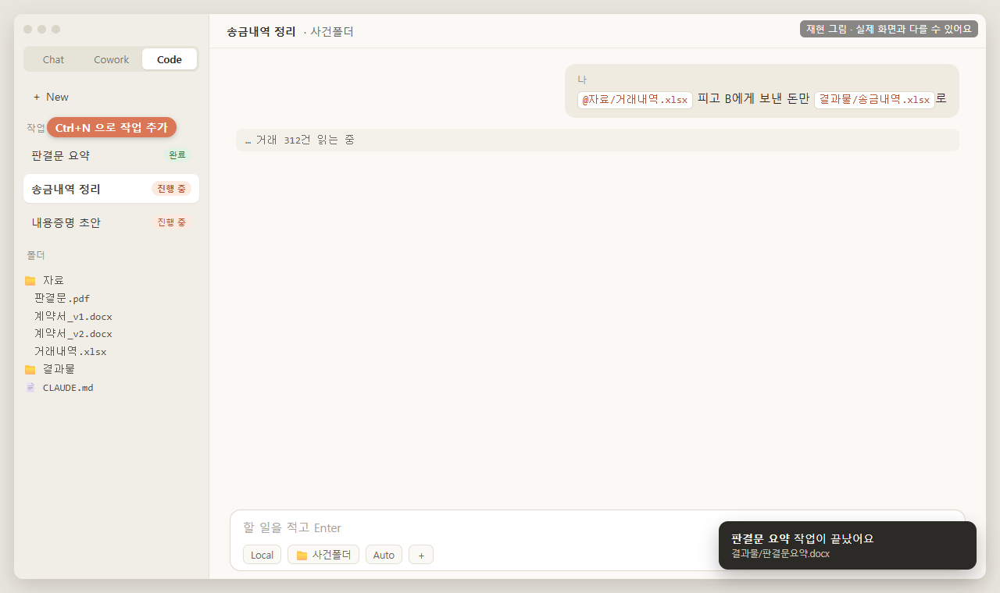
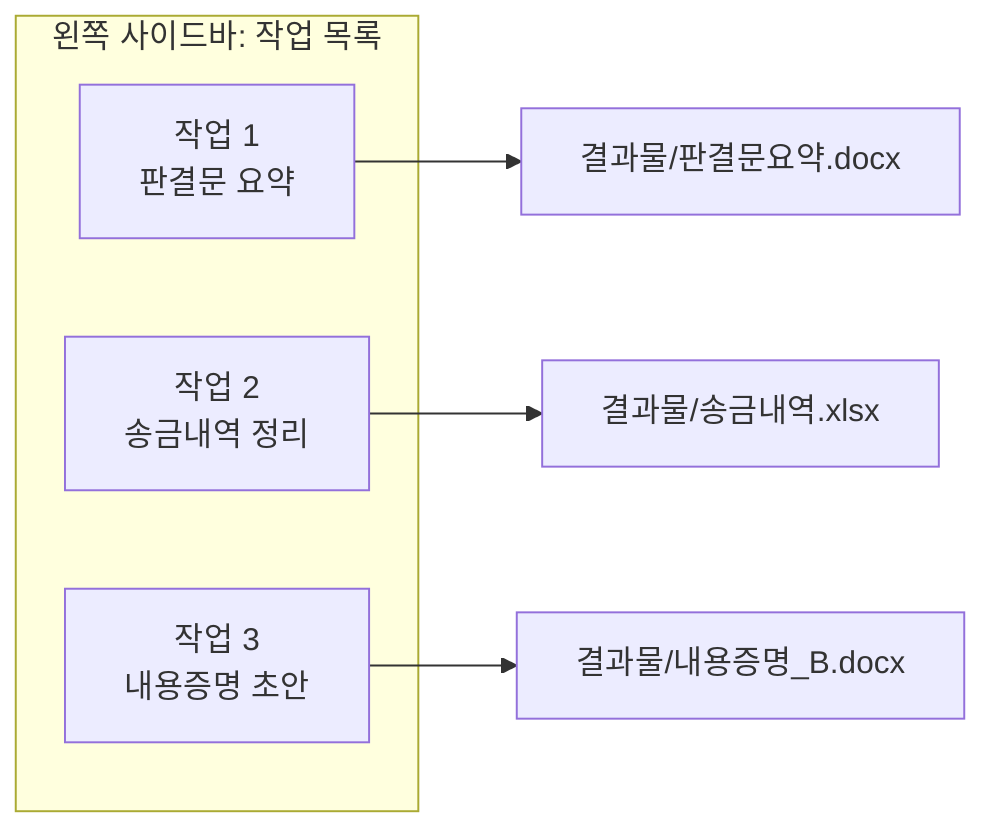
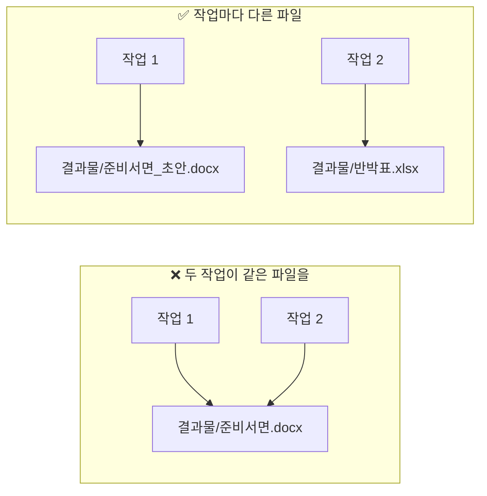

# 11. 여러 작업 동시에

Code 탭에서는 **작업(세션)을 여러 개 열어 동시에** 돌릴 수 있어요. Windows 앱도 똑같아요.
판결문을 요약하는 동안 다른 작업에서 송금내역을 정리하고, 또 다른 작업에서 내용증명을 쓰게 할 수 있어요.

*재현 그림: 사이드바에 작업 세 개, 끝난 작업은 알림으로*

## 여는 법, 오가는 법

| 하고 싶은 것 | 방법 |
|---|---|
| 새 작업 열기 | 사이드바 **+ New** 또는 **Ctrl+N** |
| 작업 사이 이동 | 사이드바에서 클릭, 또는 **Ctrl+Tab** / **Ctrl+Shift+Tab** |
| 두 작업 나란히 보기 | **Alt**를 누른 채 사이드바의 작업 클릭 (또는 오른쪽 클릭 › Open in › Split view) |
| 작업을 새 창으로 | **Ctrl**을 누른 채 클릭 (또는 오른쪽 클릭 › Open in › New window) |
| 나란히 보기 끝내기 | **Ctrl+Alt+W** |
| 한 작업만 멈추기 | 그 작업에서 **Esc** |

## 끝나면 알려 줘요
다른 작업을 보고 있을 때 어떤 작업이 끝나면 **Windows 알림**이 떠요. 알림을 보고 그 작업으로 가서 결과를 확인하면 돼요.

> ⚠️ 작업은 **앱이 켜져 있는 동안만** 돌아가요. 앱을 닫으면 멈춰요.

## 꼭 지킬 것: 같은 파일은 한 작업만

동시에 도는 작업들은 **같은 폴더의 같은 파일**을 보고 있어요. 두 작업이 같은 파일을 고치면 서로 덮어써요.
- 작업마다 **결과 파일 이름을 다르게** 정해 주세요.
- 같은 서면을 여러 번 고치는 일은 **한 작업 안에서** 이어서 하세요.
- (심화) 개발자용 **Worktree** 기능을 켜면 작업마다 폴더 사본에서 일해서 서로 안 부딪혀요. 다만 결과 파일도 사본 폴더에 생겨서 헷갈릴 수 있어요. 처음에는 "파일 이름 다르게"로 충분해요.

## 예시: 세 가지 일을 한꺼번에 맡기기
**작업 1** (Ctrl+N)
> **🙋 나** `@자료/판결문.pdf` 쟁점, 주장, 판단으로 한 장 요약해서 `결과물/판결문요약.docx`로

**작업 2** (Ctrl+N)
> **🙋 나** `@자료/거래내역.xlsx` 피고 B에게 보낸 돈만 `결과물/송금내역.xlsx`로

**작업 3** (Ctrl+N)
> **🙋 나** 매수인 B에게 잔금 지급 요구하는 내용증명 `결과물/내용증명_B.docx`로

세 작업이 동시에 돌고, 끝나는 대로 알림이 와요. 결과 파일 이름이 모두 달라서 서로 부딪히지 않아요.

## 언제 나눠서 돌리나

| 동시에 돌려도 좋은 일 | 한 작업에서 이어서 할 일 |
|---|---|
| 서로 다른 파일을 만드는 일 | 같은 서면을 계속 다듬는 일 |
| 서로 결과가 필요 없는 일 | 판결문 요약을 보고 서면 방향을 정하는 일 |
| 기록 PDF 수십 개 정리 같은 오래 걸리는 일 | 짧게 묻고 답하는 일 |

*💬 예시 대화와 재현 그림은 이해를 돕기 위해 만든 것이에요. 사건, 이름, 숫자는 모두 가상이고 실제 답은 조금 다를 수 있어요.*

📖 공식: [데스크톱 앱의 Claude Code: 여러 세션](https://code.claude.com/docs/en/desktop)
