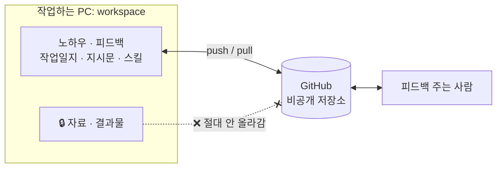

# 01. 작업 폴더

```
workspace/
├── CLAUDE.md          ← 규칙과 시작하자·마무리하자 절차
├── 노하우.md          ← 작업할수록 쌓이는 요령
├── 피드백.md          ← 피드백
├── 작업일지/          ← 작업마다 남는 기록
├── 재사용/지시문/     ← 잘된 지시문
├── .claude/skills/    ← 스킬과 목록.md
│
├── 자료/              ← 작업할 파일 사본     🔒 GitHub에 안 올라감
└── 결과물/            ← Claude가 만든 파일   🔒 GitHub에 안 올라감
```



## 세팅 체크리스트
- [ ] 기초 트랙 01편대로 앱, Git 설치
- [ ] GitHub CLI(gh) 설치 후 `gh auth login`
- [ ] 비공개 저장소를 만들고 [템플릿](템플릿/) 내용을 복사
- [ ] 저장소를 `문서\workspace`에 clone
- [ ] `템플릿/user-settings.json` 내용을 `C:\Users\<사용자>\.claude\settings.json`에 (Auto 기본값)
- [ ] Code 탭 → Local → `workspace` 선택 → 권한 모드 Auto 확인 → "시작하자"로 테스트
