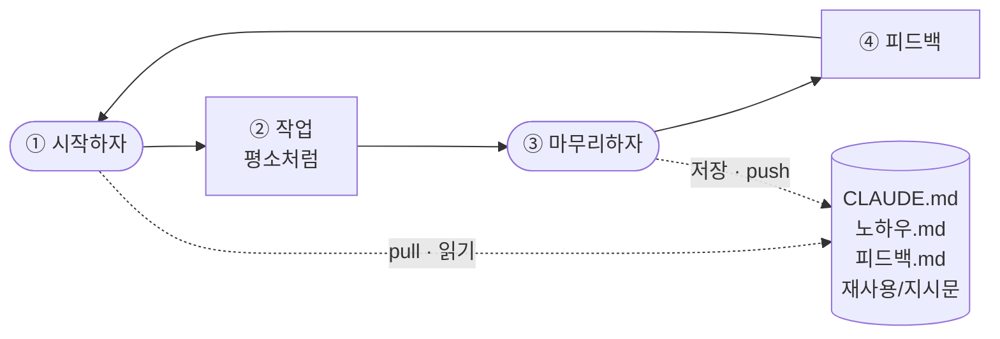
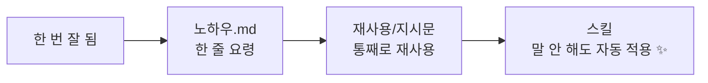

# 02. 작업 순환: 오늘 한 일을 다음에 다시 쓰기

Claude는 작업이 끝나면 잊어요. 그래서 **폴더에 기억을 남기고, 다음에 다시 읽게** 해요.
할 말은 딱 두 개예요: **"시작하자"**, **"마무리하자"**

## ① "시작하자"
1. GitHub에서 최신 내용을 받아요 (피드백 포함)
2. `노하우.md`, `피드백.md`를 읽고 반영해요
3. `재사용/지시문/`에 비슷한 작업이 있으면 먼저 알려 줘요

## ② 작업
기초 트랙 04~06편처럼 시키고 다듬어요.

## ③ "마무리하자"

| 남기는 것 | 어디에 | 다음에 어떻게 쓰이나 |
|---|---|---|
| 작업일지 | `작업일지/` | 피드백 주는 사람이 확인 |
| 새로 알게 된 요령 | `노하우.md` | 다음 시작 때 자동 반영 |
| 잘된 지시문 | `재사용/지시문/` | 비슷한 작업에서 재사용 |
| (자주 쓰는 방식) | `.claude/skills/` | 스킬이 되어 자동 적용 |

그리고 GitHub에 올려요. `자료/`, `결과물/`은 **절대 안 올라가요.**

## 쌓이는 단계

같은 지시문을 **세 번 이상** 쓰면 Claude가 "스킬로 만들까요?"라고 물어봐요.

이 절차는 [템플릿의 CLAUDE.md](템플릿/CLAUDE.md)에 적혀 있어서 Claude가 자동으로 따라요.
