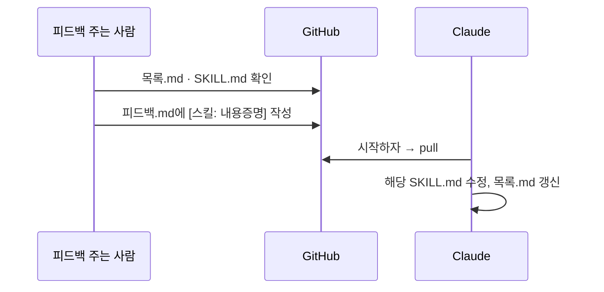

# 03. 스킬 관리

스킬 자체는 [기초 트랙 08편](../기초/08-스킬.md)을 보세요. 여기서는 **스킬을 목록으로 관리하고 피드백으로 다듬는 방식**을 다뤄요.

## 목록.md (Claude가 자동으로 관리)
`.claude/skills/목록.md`
| 스킬 | 용도 | 상태 | 최근 수정 | 메모 |
|---|---|---|---|---|
| 내용증명 | 내용증명 초안 | ✅ 안정 | 2026-11-20 | 피드백 2회 반영 |
| 판결문-요약 | 판결문 한 장 요약 | 🧪 시험중 | 2026-11-22 | |

- 새 스킬은 `🧪 시험중`, 피드백 없이 세 번 이상 잘 쓰이거나 확인을 받으면 `✅ 안정`
- 스킬을 만들거나 고치거나 지우면 Claude가 표를 갱신

## 스킬별 피드백

```
## [스킬: 내용증명] 2026-11-21
- 마지막에 "회신이 없으면 법적 조치" 문단을 선택 사항으로 추가
상태: 미반영
```
`SKILL.md`를 직접 고쳐서 push해도 돼요.
