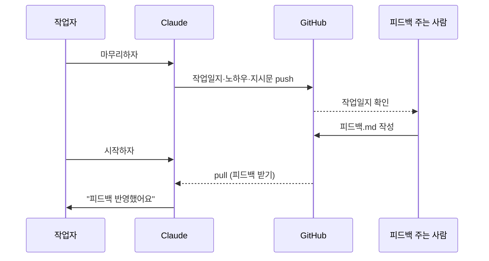

# 04. 피드백 주고받기



## 피드백 주는 사람이 보는 것
- `작업일지/`: 어떻게 시켰고 무엇이 잘 안 됐는지
- `노하우.md`, `재사용/`, `.claude/skills/`: 쌓이고 있는 요령
- ❌ 실제 파일(`자료/`, `결과물/`)은 GitHub에 없어서 볼 수 없어요

## 피드백.md 쓰는 법
```
## 2026-11-20 내용증명 초안
- 요구사항을 맨 앞에 두라고 지시하면 더 좋음
상태: 미반영
```
Claude가 반영하면 `상태: 반영됨`으로 바꾸고, 계속 쓸 요령은 `노하우.md`로 옮겨요.

## ⚠️
일지와 노하우는 GitHub에 올라가요. **방식만** 적고, 사건 내용·개인정보는 적지 않아요. (템플릿 CLAUDE.md에 규칙으로 들어 있어요)
